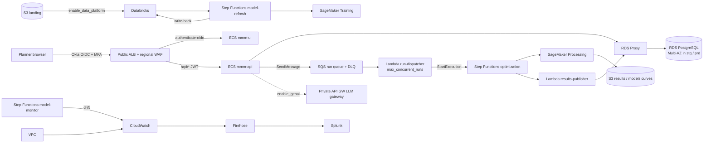

# WBD MMM – Media Allocation & Measurement Platform: DevOps Implementation

Infrastructure-as-code, deployment and CI/CD for the WBD Media-Mix-Modeling (MMM) platform,
running on **Amazon ECS on AWS Fargate** in three WBD-owned AWS accounts: **dev**, **staging**
and **prod**.

This repository contains only DevOps work: Terraform, ECS task definitions, GitHub Actions
pipelines, scripts and operational documentation. Application code (`apps/api`, `apps/ui`,
`apps/sagemaker-optimizer`, `apps/sagemaker-training`, `apps/results-publisher`) is owned by the
development teams; the pipelines here build, scan and deploy their artifacts.

---

## 1. What the platform does

WBD has a finite pool of owned-and-operated (O&O) promotional inventory (linear GRPs, digital
impressions, Tier 1 dollars) plus paid media budget. Three business units compete for it:

| Business unit | Native KPI | Converted to enterprise value via |
|---|---|---|
| US Networks | Ratings (Live+3, target demo) | Revenue-based multiplier |
| Streaming (HBO Max) | Attributed revenue / renewals | Per-subscriber LTV multiplier |
| Theatrical | 3-day opening box office | Box-office LTV multiplier |

The platform replaces a third-party tool. It:

1. Ingests media and outcome data (S3 landing → Databricks feature engineering when the data platform is on).
2. Refreshes media-mix models per business unit (Step Functions model refresh → Databricks job → SageMaker training and evaluation → SageMaker Model Registry → Databricks write-back of predictions and lift), and watches them for drift (model-monitor state machine per business unit).
3. Runs a constrained optimizer asynchronously with a limit on concurrent runs (API → SQS run queue → dispatcher Lambda → Step Functions → SageMaker Processing → results publisher Lambda → RDS PostgreSQL).
4. Gives planners a web UI and API for scenarios, comparison, synchronous what-if, overrides and exports (ECS `ui` + `api` behind an ALB that signs users in with WBD Okta over OIDC).
5. Release 2 adds GenAI (private API Gateway LLM gateway, external providers, Bedrock Guardrails) behind `enable_genai`.

## 2. Target architecture



| Layer | AWS services |
|---|---|
| Identity | IAM Identity Center + Okta (engineers), GitHub OIDC (pipelines), ECS task roles, Okta OIDC at the ALB (planners) |
| Network | VPC /19, public / private-app / private-data / private-endpoint subnets, NAT, VPC endpoints, Transit Gateway (WBD hub) |
| Compute | ECS Fargate: `api`, `ui`, one-off `migrate` and `platform-check`; Step Functions; SageMaker Processing / Training; Lambda publisher and run dispatcher |
| Data | RDS PostgreSQL + RDS Proxy (IAM auth, TLS), SQS run queue (KMS), S3 (versioned, KMS, Object Lock), SageMaker Model Registry |
| Front door | Public ALB with Okta OIDC sign-in, regional WAF, ACM, optional Route 53 |
| Security | KMS, Secrets Manager, SSM, permission boundary, Inspector / Trivy / Checkov |
| Observability | CloudWatch (Container Insights, alarms, dashboards), SNS, Firehose → Splunk |
| Resilience | RDS Multi-AZ (stg / prd) and PITR, AWS Backup (+ vault lock and cross-region copy in prod), SQS DLQ |
| Data platform | EventBridge Scheduler + `mmm.refresh`, Step Functions model refresh (with Databricks write-back) and model monitor (drift), Databricks Unity Catalog access |
| GenAI (R2) | Bedrock Guardrails, private API Gateway + proxy Lambda, provider keys in Secrets Manager |

## 3. Environments

| Setting | dev | staging | prod |
|---|---|---|---|
| AWS account | `wbd-mmm-dev` | `wbd-mmm-stage` | `wbd-mmm-prod` |
| Name prefix | `mmm-dev-` | `mmm-stg-` | `mmm-prd-` |
| Availability Zones | 2 | 3 | 3 |
| NAT gateways | 1 | 1 per AZ | 1 per AZ |
| API / UI tasks | 1–2 / 1–2 | 2–4 / 2–3 | 3–10 / 2–6 |
| RDS PostgreSQL | `db.t4g.medium`, Single-AZ | `db.r6g.large`, Multi-AZ | `db.r6g.xlarge`, Multi-AZ |
| Concurrent optimization runs | 5 | 20 | 50 |
| Backups | RDS PITR 7 d + AWS Backup | RDS PITR 14 d + AWS Backup | RDS PITR 35 d + AWS Backup + vault lock + cross-region copy (when approved) |
| Log retention | 30 days | 90 days | 365 days + Splunk |
| Data allowed | synthetic / masked | approved prod-like clone | production |
| Deploy approval | automatic on merge | EY delivery lead | WBD approver + CAB |

Each account has its **own ECR registry** (`mmm/api`, `mmm/ui`, `mmm/sagemaker-optimizer`,
`mmm/sagemaker-training`). CI builds once in dev; promotion copies the same digest to staging on
`vX.Y.Z-rcN` and to prod on `vX.Y.Z`.

Decisions taken: account security baseline (CloudTrail, GuardDuty, Security Hub, Config, SCPs) is
owned by WBD and verified here. Data orchestration uses Databricks + Step Functions behind
`enable_data_platform`.

## 4. Repository layout

```
wbd_devops_implmenetation_1/
├── README.md                 this file
├── docs/                     architecture, access, OIDC, Okta, secrets, operations guides
│   └── runbooks/             deploy, rollback, scaling, restore, ECS, rotation, pipeline, model, drift, write-back, sign-in, GenAI, optimization failures, security, break-glass
├── scripts/                  deploy, smoke, platform-check, lambda-release, model governance, setup-github, sync-environments, …
├── apps/                     reference or team-owned application folders (pipeline skips missing folders)
├── infra/
│   ├── bootstrap/            Terraform state bucket + KMS per account
│   ├── modules/              reusable Terraform modules
│   └── environments/
│       ├── dev/              source stack (edit here)
│       ├── staging/          sync from dev
│       └── prod/             sync from dev
├── ecs/                      task definition templates per environment (api, ui, migrate)
├── data/                     model thresholds; Databricks bundle under data/databricks/ when present
└── .github/workflows/        api-ci, ui-ci, optimizer-ci, training-ci, publisher-ci, deploy, terraform, databricks, model-governance, repo-checks
```

## 5. Implementation steps

| Step | What | Status |
|---|---|---|
| 0 | Prerequisite tools, access, skeleton, guides | ✅ Validated |
| 1 | Bootstrap Terraform state (S3 + KMS), per account | ✅ Validated (apply pending accounts) |
| 2 | Terraform module skeletons | ✅ Validated |
| 3 | Foundation: KMS, permission boundary, GitHub OIDC + roles, budgets | ✅ Validated (apply pending accounts) |
| 4 | Networking: VPC, subnets, NAT, endpoints, security groups | ✅ Validated (apply pending accounts) |
| 5 | Secrets Manager / SSM containers (out-of-band values) | ✅ Validated (apply pending accounts) |
| 6 | Platform: ECR, S3, RDS PostgreSQL + Proxy | ✅ Validated (apply pending accounts) |
| 7 | ECS cluster, ALB, `api` / `ui`, optimization (SQS run queue + dispatcher, Step Functions + SageMaker + publisher) | ✅ Validated (apply pending accounts) |
| 8 | Front door: Okta OIDC sign-in at the ALB, regional WAF, ACM, DNS outputs, Okta app settings | ✅ Validated (apply pending accounts) |
| 9 | Monitoring, dashboards, Splunk shipping | ✅ Validated (apply pending accounts) |
| 10 | Backup and DR | ✅ Validated (apply pending accounts) |
| 11 | CI/CD pipelines, GitHub Environments | ✅ Validated (apply pending accounts) |
| 12 | Promote platform to staging, then prod | ✅ Validated (apply pending accounts) |
| 13 | Data platform: model refresh + write-back, drift monitor, Databricks access, governance (curves + baseline + `approval.json`) | ✅ Code done (flag off until WBD values) |
| 14 | Release 2: LLM gateway + guardrails (`enable_genai`) | ✅ Code done (after Release 1 gate) |
| 15 | Runbooks and handover | ✅ Written |

Deferred until WBD provides details: CODEOWNERS, Route 53 in-account, account security baseline.

## 6. Conventions

**Naming:** `mmm-<env>-<component>`, with `env` = `dev` | `stg` | `prd`. Secrets: `mmm/<env>/<service>/<name>`.
SSM: `/mmm/<env_short>/...`.

**Mandatory tags:** `Application`, `Environment`, `Owner`, `BusinessUnit`, `DataClassification`,
`ManagedBy`, `Component`.

**Placeholder values** use `# add actual value` in tfvars; see `docs/01-client-inputs-tracker.md`.

**Golden rules**

1. Terraform applied by GitHub Actions through OIDC (exception: one-time bootstrap).
2. No secrets in Git, images, task env or Terraform variables.
3. Edit `infra/environments/dev`, then `scripts/sync-environments.ps1`.
4. Build dev → prove → staging → prod.

## 7. Getting started

0. Clone: `git clone https://github.com/Yashwanth-wbd/wbd-aws-devops.git`
1. Tools: `powershell -ExecutionPolicy Bypass -File .\scripts\install-prereqs.ps1` — [docs/00-prerequisites.md](docs/00-prerequisites.md)
2. AWS access: [docs/02-aws-access-sso-cli.md](docs/02-aws-access-sso-cli.md)
3. GitHub OIDC: [docs/03-github-oidc.md](docs/03-github-oidc.md)
4. Planner login (Okta OIDC at the ALB): [docs/04-okta-mfa-app-login.md](docs/04-okta-mfa-app-login.md)
5. Secrets: [docs/05-secrets-and-config.md](docs/05-secrets-and-config.md)
6. Authorization: [docs/06-authorization-model.md](docs/06-authorization-model.md)
7. Branching and release: [docs/07-branching-and-release.md](docs/07-branching-and-release.md)
8. Backup and DR: [docs/08-backup-and-dr.md](docs/08-backup-and-dr.md)
9. CI/CD: [docs/09-cicd-pipelines.md](docs/09-cicd-pipelines.md)
10. Data platform and model governance: [docs/10-data-platform-and-model-governance.md](docs/10-data-platform-and-model-governance.md)
11. Release 1 gate: [docs/11-release-1-readiness.md](docs/11-release-1-readiness.md)
12. Release 2 GenAI: [docs/12-genai-bedrock.md](docs/12-genai-bedrock.md)
13. Operations: [docs/13-operations-and-handover.md](docs/13-operations-and-handover.md), [runbooks](docs/runbooks/README.md)

## 8. Documentation index

| Document | Contents |
|---|---|
| [00-prerequisites](docs/00-prerequisites.md) | Tools, install, proxy |
| [01-client-inputs-tracker](docs/01-client-inputs-tracker.md) | Placeholders and owners |
| [02-aws-access-sso-cli](docs/02-aws-access-sso-cli.md) | SSO profiles, break-glass |
| [03-github-oidc](docs/03-github-oidc.md) | Pipeline roles |
| [04-okta-mfa-app-login](docs/04-okta-mfa-app-login.md) | Okta OIDC at the ALB, ALB JWT, sign-in switch |
| [05-secrets-and-config](docs/05-secrets-and-config.md) | Secrets, SSM, rotation |
| [06-authorization-model](docs/06-authorization-model.md) | IAM, task roles, RLS |
| [07-branching-and-release](docs/07-branching-and-release.md) | Tags, promotion |
| [08-backup-and-dr](docs/08-backup-and-dr.md) | RPO/RTO, RDS / S3 restore |
| [09-cicd-pipelines](docs/09-cicd-pipelines.md) | Workflows, deploy, rollback |
| [10-data-platform-and-model-governance](docs/10-data-platform-and-model-governance.md) | Model refresh, Databricks, SageMaker registry |
| [11-release-1-readiness](docs/11-release-1-readiness.md) | Gate checklist |
| [12-genai-bedrock](docs/12-genai-bedrock.md) | LLM gateway, guardrails |
| [13-operations-and-handover](docs/13-operations-and-handover.md) | Schedule, alarms → runbooks |
| [runbooks/](docs/runbooks/README.md) | Operational procedures |
