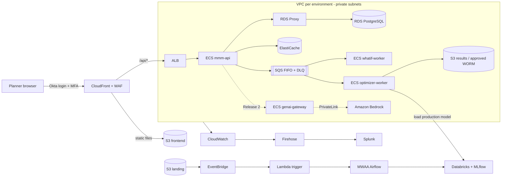

# WBD MMM – Media Allocation & Measurement Platform: DevOps Implementation

Infrastructure-as-code, deployment and CI/CD for the WBD Media-Mix-Modeling (MMM) platform,
running on **Amazon ECS on AWS Fargate** in three WBD-owned AWS accounts: **dev**, **staging**
and **prod**.

This repository contains only DevOps work: Terraform, ECS task definitions, GitHub Actions
pipelines, scripts and operational documentation. Application code (`apps/api`,
`apps/optimizer-worker`, `apps/frontend`) is owned by the development teams; the pipelines
here build, scan and deploy their containers.

---

## 1. What the platform does

WBD has a finite pool of owned-and-operated (O&O) promotional inventory (linear GRPs, digital
impressions, Tier 1 dollars) plus paid media budget. Three business units compete for it:

| Business unit | Native KPI | Converted to enterprise value via |
|---|---|---|
| US Networks | Ratings (Live+3, target demo) | Revenue-based multiplier |
| Streaming (HBO Max) | Attributed revenue / renewals | Per-subscriber LTV multiplier |
| Theatrical | 3-day opening box office | Box-office LTV multiplier |

The platform replaces a third-party tool. It:

1. Ingests media and outcome data (S3 → MWAA → Databricks).
2. Trains media-mix models per business unit (Databricks + MLflow).
3. Runs a constrained optimizer that recommends allocation by title × channel × week
   (ECS Fargate workers, fed by SQS).
4. Gives planners a web app for scenarios, comparison, what-if, overrides and exports
   (React on CloudFront + FastAPI on ECS).
5. Release 2 adds GenAI (natural-language setup, narratives, copilot) through Amazon Bedrock.

## 2. Target architecture



| Layer | AWS services |
|---|---|
| Identity | IAM Identity Center + Okta (engineers), GitHub OIDC (pipelines), ECS task roles (services), Okta OIDC + MFA (planners) |
| Network | VPC /19, public / private-app / private-data / private-endpoint subnets, NAT, VPC endpoints, Transit Gateway (WBD hub) |
| Compute | ECS on Fargate: `api`, `whatif-worker`, `optimizer-worker`, `migrate` (one-off), `genai-gateway` (R2) |
| Data | RDS PostgreSQL + RDS Proxy, ElastiCache (Redis/Valkey), SQS FIFO + DLQ, S3 (versioned, KMS, Object Lock) |
| Edge | CloudFront, WAF, ACM, Route 53 |
| Security | KMS, Secrets Manager, SSM Parameter Store, permission boundary, Inspector / Trivy / Checkov |
| Observability | CloudWatch (Container Insights, Application Signals, alarms, dashboards), SNS, Firehose → Splunk |
| Resilience | RDS PITR, AWS Backup (+ vault lock and cross-region copy in prod), ElastiCache snapshots |
| Data platform | MWAA, EventBridge + Lambda trigger, Databricks (Unity Catalog, MLflow) via PrivateLink |
| GenAI (R2) | Bedrock, Guardrails, Bedrock PrivateLink endpoint, invocation logging |

## 3. Environments

| Setting | dev | staging | prod |
|---|---|---|---|
| AWS account | `wbd-mmm-dev` | `wbd-mmm-stage` | `wbd-mmm-prod` |
| Name prefix | `mmm-dev-` | `mmm-stg-` | `mmm-prd-` |
| Availability Zones | 2 | 3 | 3 |
| NAT gateways | 1 | 1 per AZ | 1 per AZ |
| API tasks | 1 | 2 | 3 |
| RDS | single-AZ, small | Multi-AZ | Multi-AZ, deletion protection |
| ElastiCache | single node | primary + replica | primary + replica, auto-failover |
| Backups | RDS automated only | AWS Backup | AWS Backup + vault lock + cross-region copy |
| Log retention | 30 days | 90 days | 365 days + Splunk |
| Data allowed | synthetic / masked | approved prod-like clone | production |
| Deploy approval | automatic on merge | EY delivery lead | WBD approver + CAB |

Each account has its **own ECR registry** (`mmm/api`, `mmm/optimizer-worker`, and
`mmm/genai-gateway` in Release 2; the what-if worker runs the optimizer image). CI builds and
scans an image once and pushes it to dev ECR. Promotion copies that exact image (same digest)
to staging ECR on a `vX.Y.Z-rcN` tag and to prod ECR on a `vX.Y.Z` tag, so prod never depends
on the dev account.

Decisions taken: the account security baseline (CloudTrail, GuardDuty, Security Hub, Config,
SCPs) is owned by WBD and only verified, not created here. Data orchestration uses MWAA +
EventBridge + Lambda behind an `enable_data_platform` switch.

## 4. Repository layout

Folders are added step by step. ✅ = created so far.

```
wbd_devops_implmenetation_1/
├── README.md                 ✅ this file
├── .gitignore                ✅
├── .tflint.hcl               ✅ tflint rules used locally and in CI
├── docs/                     ✅ architecture, access, OIDC, Okta, secrets, authorization guides, Release 1 gate, GenAI, operations
│   └── runbooks/             ✅ Step 15 – deploy, rollback, scaling, DLQ, restore, cache, ECS, rotation, pipeline, model, GenAI, security, break-glass
├── scripts/                  ✅ install-prereqs, checkov-scan, validate-modules, secret-scan, setup-github; deploy scripts used by the pipelines
├── apps/
│   └── genai-gateway/        ✅ Step 14 – reference GenAI gateway (FastAPI, guardrail on every Bedrock call); other apps belong to the app teams
├── infra/
│   ├── bootstrap/            ✅ Step 1 – Terraform state bucket + KMS key (per account)
│   ├── modules/              ✅ Steps 2–14 – 23 reusable modules (see infra/modules/README.md)
│   └── environments/
│       ├── dev/              ✅ Steps 3–14 foundation, network, secrets, platform, ECS, edge, monitoring, backup, pipeline roles, data platform (data.tf), GenAI (genai.tf)
│       ├── staging/          ✅ Step 12 – same code as dev (scripts/sync-environments.ps1); own backend + tfvars
│       └── prod/             ✅ Step 12 – same code as dev; own backend + tfvars
├── ecs/                      ✅ Steps 11–14 – app-owned task definition settings used by deploy.yml (dev, staging, prod)
├── data/                     ✅ Step 13 – Airflow DAGs, requirements.txt, data-quality suites, run-manifest schema, model thresholds
└── .github/                  ✅ Steps 11–15 – workflows (api/optimizer/genai/frontend CI, deploy, terraform, repo checks, data, model-governance), dependabot.yml
```

## 5. Implementation steps

The build follows `devops_plan_1.txt`. Each step is done on its own, validated, and only then
does the next one start.

| Step | What | Status |
|---|---|---|
| 0 | Prerequisite tools, access, project skeleton, guides | ✅ Validated |
| 1 | Bootstrap Terraform state (S3 + KMS, S3 lock file; DynamoDB optional), per account | ✅ Validated (apply pending accounts) |
| 2 | Terraform module skeletons (23 modules) | ✅ Validated |
| 3 | Foundation (dev): KMS, permission boundary, GitHub OIDC + roles, budgets | ✅ Validated (apply pending accounts) |
| 4 | Networking: VPC, subnets, NAT, endpoints, security groups, flow logs | ✅ Validated (apply pending accounts) |
| 5 | Security baseline: Secrets Manager / SSM containers | ✅ Validated (apply pending accounts) |
| 6 | Platform: ECR, S3, RDS + Proxy, ElastiCache, SQS | ✅ Validated (apply pending accounts) |
| 7 | ECS: cluster, ALB, services, autoscaling, Application Signals | ✅ Validated (apply pending accounts) |
| 8 | Edge: WAF, ACM, CloudFront, (Route 53 later), Okta wiring | ✅ Validated (apply pending accounts) |
| 9 | Monitoring and logging: alarms, dashboards, Firehose → Splunk | ✅ Validated (apply pending accounts) |
| 10 | Backup and DR | ✅ Validated (apply pending accounts) |
| 11 | CI/CD pipelines, GitHub Environments and variables | ✅ Validated (apply pending accounts) |
| 12 | Promote platform to staging, then prod | ✅ Validated (apply pending accounts) |
| 13 | Data-team platform: MWAA, data trigger, Databricks access, model governance | ✅ Code done (validation deferred until client values and accounts) |
| 🚦 | **Release 1 complete gate** – checklist and evidence in [docs/11](docs/11-release-1-readiness.md) | 📋 Gate pack ready – sign-offs open |
| 14 | Release 2: Bedrock GenAI gateway (behind `enable_genai`, default off) – [docs/12](docs/12-genai-bedrock.md) | ✅ Code done (validated offline; apply after the Release 1 gate and WBD model approval) |
| 15 | Handover runbooks and operations – [docs/13](docs/13-operations-and-handover.md), [runbooks](docs/runbooks/README.md) | ✅ Written (KT sessions and sign-offs at handover) |

Deferred until the client provides details: CODEOWNERS reviewers, Route 53 DNS records,
account-level security baseline (owned by WBD).

## 6. Conventions

**Naming:** `mmm-<env>-<component>`, with `env` = `dev` | `stg` | `prd` (e.g. `mmm-prd-vpc`,
`mmm-dev-jobs.fifo`). Secrets: `mmm/<env>/<service>/<name>`. SSM: `/mmm/<env>/<name>`.

**Mandatory tags on every resource:** `Application`, `Environment`, `Owner`,
`BusinessUnit`, `DataClassification`, `ManagedBy`, `Component`. The `CostCenter` tag from the
plan is left out by decision; add it back in the `tags` locals if WBD Finance asks for chargeback.

**Placeholder values.** No client values (account IDs, CIDRs, Okta, Databricks, Splunk, …)
have been shared yet. Every placeholder has this comment on the line above it:

```hcl
# add actual value
aws_account_id = "111111111111"
```

To find every value that still needs replacing:

```powershell
git grep -n -A1 "add actual value"
```

`docs/01-client-inputs-tracker.md` lists every placeholder, where it is used and which
client team owns it.

**Golden rules**

1. Everything is Terraform, applied only by GitHub Actions through OIDC. The single
   exception is the one-time state bootstrap (Step 1), run by a DevOps engineer through SSO.
2. No secrets in Git, images, task-definition environment variables or Terraform variables.
3. Same code for all environments; only `backend.tf` and `terraform.tfvars` differ. Change
   `infra/environments/dev`, then run `scripts/sync-environments.ps1` (CI fails on drift).
4. Build dev → prove it works → staging → prod.

## 7. Getting started

0. Clone the repository (a local `C:\` folder is much faster than a network share):
   `git clone https://github.com/Yashwanth-wbd/wbd-aws-devops.git`
1. Install the tools (no admin rights needed):
   `powershell -ExecutionPolicy Bypass -File .\scripts\install-prereqs.ps1`
   Details: [docs/00-prerequisites.md](docs/00-prerequisites.md)
2. Get AWS access through Okta + IAM Identity Center:
   [docs/02-aws-access-sso-cli.md](docs/02-aws-access-sso-cli.md)
3. Understand how pipelines log in to AWS without keys:
   [docs/03-github-oidc.md](docs/03-github-oidc.md)
4. Understand planner login, MFA and step-up MFA:
   [docs/04-okta-mfa-app-login.md](docs/04-okta-mfa-app-login.md)
5. Where every secret and setting lives: [docs/05-secrets-and-config.md](docs/05-secrets-and-config.md)
6. Who can do what (engineers, pipelines, services, planners):
   [docs/06-authorization-model.md](docs/06-authorization-model.md)
7. Branching, release tags and promotion: [docs/07-branching-and-release.md](docs/07-branching-and-release.md)
8. Backup, restore and DR (RPO/RTO): [docs/08-backup-and-dr.md](docs/08-backup-and-dr.md)
9. CI/CD pipelines, GitHub setup, releases and rollback: [docs/09-cicd-pipelines.md](docs/09-cicd-pipelines.md)
10. Data platform (MWAA, Databricks) and model promotion: [docs/10-data-platform-and-model-governance.md](docs/10-data-platform-and-model-governance.md)
11. Release 1 gate (before Release 2): [docs/11-release-1-readiness.md](docs/11-release-1-readiness.md)
12. Release 2 GenAI (Bedrock, guardrails, gateway): [docs/12-genai-bedrock.md](docs/12-genai-bedrock.md)
13. Running the platform, schedule, handover: [docs/13-operations-and-handover.md](docs/13-operations-and-handover.md) and [docs/runbooks/](docs/runbooks/README.md)

## 8. Documentation index

| Document | Contents |
|---|---|
| [00-prerequisites](docs/00-prerequisites.md) | Tools, versions, install, corporate proxy, Docker note |
| [01-client-inputs-tracker](docs/01-client-inputs-tracker.md) | Every placeholder value and the question to the client |
| [02-aws-access-sso-cli](docs/02-aws-access-sso-cli.md) | Okta → IAM Identity Center, permission sets, `aws configure sso`, profiles, break-glass |
| [03-github-oidc](docs/03-github-oidc.md) | GitHub OIDC provider, trust policies, roles, workflow usage |
| [04-okta-mfa-app-login](docs/04-okta-mfa-app-login.md) | Okta app per environment, PKCE, MFA, step-up, claims, token validation |
| [05-secrets-and-config](docs/05-secrets-and-config.md) | Secrets Manager vs SSM vs GitHub variables, injection into ECS, rotation |
| [06-authorization-model](docs/06-authorization-model.md) | IAM, permission boundary, task roles, app roles, PostgreSQL row-level security |
| [07-branching-and-release](docs/07-branching-and-release.md) | Trunk-based branching, release tags, promotion flow, rollback |
| [08-backup-and-dr](docs/08-backup-and-dr.md) | RPO/RTO per failure, what protects what, RDS / S3 restore, rebuild, region DR, test schedule |
| [09-cicd-pipelines](docs/09-cicd-pipelines.md) | Workflows, GitHub Environments and variables, app-team contract, release steps, rollback, troubleshooting |
| [10-data-platform-and-model-governance](docs/10-data-platform-and-model-governance.md) | Data flow, MWAA, trigger idempotency, Databricks setup (Unity Catalog role, PrivateLink, service principals), DAG release, model thresholds, approval, rollback |
| [11-release-1-readiness](docs/11-release-1-readiness.md) | Release 1 gate (G1–G5), rollout per environment, production readiness checklist with commands, restore / failover / performance records, Release 2 inputs |
| [12-genai-bedrock](docs/12-genai-bedrock.md) | Release 2: switches, what gets built, controls (approved models, PrivateLink, guardrail, logging, quotas), turning on / off, guardrail versions, gateway contract, validation |
| [13-operations-and-handover](docs/13-operations-and-handover.md) | RACI, ongoing operations schedule (patching, vulnerabilities, drift, access and restore tests, DR), alarm → runbook map, KT sessions, handover checklist |
| [runbooks/](docs/runbooks/README.md) | Deploy, rollback, planning-season scaling, DLQ, DB restore, cache failure, ECS task stuck, secret / certificate rotation, pipeline failure, model rollback, GenAI on / off, security incident, break-glass |
