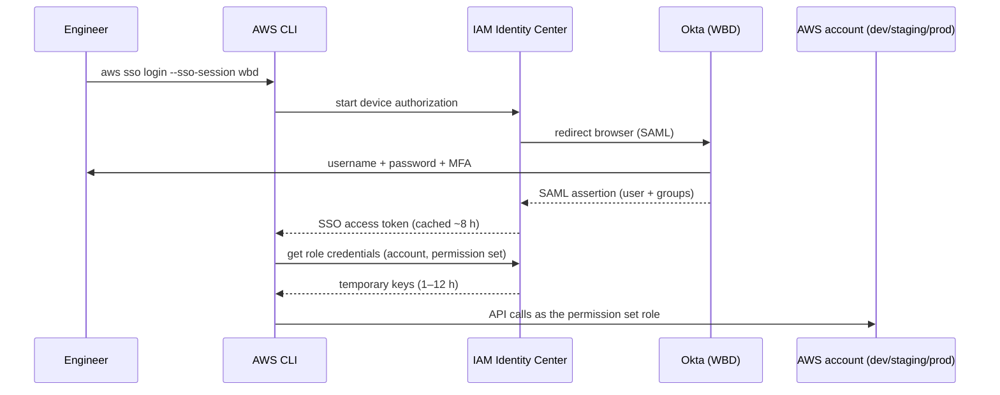

# 02 – Engineer access to AWS (Okta → IAM Identity Center → AWS CLI)

Engineers never get IAM users or access keys. They sign in with their WBD Okta account
(with MFA) and receive **short-lived credentials** for a permission set in one account.

## 1. How it fits together



| Piece | Owner | What it does |
|---|---|---|
| Okta | WBD Identity team | Identity source; enforces password + MFA |
| SAML 2.0 trust Okta → IAM Identity Center | WBD Identity team | Lets Okta sign users in to AWS |
| SCIM provisioning Okta → IAM Identity Center | WBD Identity team | Copies users and groups automatically, so access is managed only in Okta |
| Permission sets | WBD Cloud Platform team | IAM policies that become a role in each assigned account |
| Assignments (Okta group → permission set → account) | WBD Cloud Platform team | Who gets what, where |

**Linking access:** to give someone access, the WBD Identity team adds them to an Okta group
(for example `aws-mmm-dev-devops`). SCIM syncs the group to IAM Identity Center, where it is
already assigned to the `DevOps` permission set on the dev account. Removing them from the
group removes the access. No change is needed in this repository.

## 2. Permission sets to request

| Permission set | dev | staging | prod | Purpose |
|---|---|---|---|---|
| `ReadOnly` | ✔ | ✔ | ✔ | Look at resources and logs |
| `Developer` | ✔ | read-only | none | App developers: ECS, logs, S3, Step Functions in dev |
| `DevOps` | ✔ | ✔ | read-only + time-limited elevation | Bootstrap, investigate, break/fix |
| `SecurityAudit` | ✔ | ✔ | ✔ (read) | Security reviews |
| `BreakGlass` | – | – | ✔ (alerts security when used) | Emergencies only |

Suggested Okta groups (WBD to confirm):

```text
# add actual value
aws-mmm-dev-readonly     aws-mmm-dev-developer     aws-mmm-dev-devops
aws-mmm-stg-readonly     aws-mmm-stg-developer     aws-mmm-stg-devops
aws-mmm-prd-readonly     aws-mmm-prd-devops        aws-mmm-prd-breakglass
aws-mmm-all-securityaudit
```

## 3. Configure the AWS CLI (one time)

Run the wizard:

```powershell
aws configure sso
```

| Prompt | Answer |
|---|---|
| SSO session name | `wbd` |
| SSO start URL | from WBD (placeholder below) |
| SSO region | region where IAM Identity Center runs |
| SSO registration scopes | `sso:account:access` |

Then choose the account and role in the browser. Or write `%USERPROFILE%\.aws\config`
directly:

```ini
[sso-session wbd]
# add actual value
sso_start_url = https://d-0000000000.awsapps.com/start
# add actual value
sso_region = us-east-1
sso_registration_scopes = sso:account:access

[profile mmm-dev-devops]
sso_session = wbd
# add actual value
sso_account_id = 111111111111
sso_role_name = DevOps
# add actual value
region = us-east-1
output = json

[profile mmm-stg-devops]
sso_session = wbd
# add actual value
sso_account_id = 222222222222
sso_role_name = DevOps
# add actual value
region = us-east-1
output = json

[profile mmm-prd-readonly]
sso_session = wbd
# add actual value
sso_account_id = 333333333333
sso_role_name = ReadOnly
# add actual value
region = us-east-1
output = json

# prod bootstrap and first apply only (Step 12); after that the pipeline changes prod
[profile mmm-prd-devops]
sso_session = wbd
# add actual value
sso_account_id = 333333333333
sso_role_name = DevOps
# add actual value
region = us-east-1
output = json
```

## 4. Daily use

```powershell
aws sso login --sso-session wbd               # opens browser: Okta + MFA
aws sts get-caller-identity --profile mmm-dev-devops

# make a profile the default for this terminal (Terraform uses it too)
$env:AWS_PROFILE = "mmm-dev-devops"
aws sts get-caller-identity
```

Expected output (account must be the dev account):

```json
{
  "UserId": "AROAXXXXXXXXXXXX:firstname.lastname@wbd.com",
  "Account": "111111111111",
  "Arn": "arn:aws:sts::111111111111:assumed-role/AWSReservedSSO_DevOps_abc123/firstname.lastname@wbd.com"
}
```

When the session expires, run `aws sso login` again.

## 5. When engineers run Terraform

| Action | Who runs it | How |
|---|---|---|
| Step 1 bootstrap (state bucket + lock table) | DevOps engineer, once per account | Laptop, `DevOps` profile, local state |
| `terraform plan` / `apply` for environments | GitHub Actions only | OIDC roles (see [03-github-oidc.md](03-github-oidc.md)) |
| Local `terraform validate` / `fmt` | Anyone | No AWS access needed (`terraform init -backend=false`) |
| Emergency fix in prod | `BreakGlass`, logged and alerted | Followed by a PR so code matches reality |

## 6. Break-glass

- A separate `BreakGlass` permission set on prod, assigned to a small named Okta group.
- The EventBridge rule `mmm-prd-breakglass-used` (monitoring module, Step 15) sends an alert to
  `mmm-prd-alerts` on every console sign-in or change made with it (API calls need the WBD
  CloudTrail organization trail).
- Every use needs an incident ticket. Afterwards, the change is reproduced in Terraform.
  Procedure: [runbooks/break-glass.md](runbooks/break-glass.md).

## 7. Troubleshooting

| Error | Fix |
|---|---|
| `Error loading SSO Token: Token for wbd does not exist` | `aws sso login --sso-session wbd` |
| `ForbiddenException: No access` | You are not in the Okta group for that account and permission set |
| `unable to get local issuer certificate` | Set `AWS_CA_BUNDLE` (see [00-prerequisites.md](00-prerequisites.md)) |
| Terraform uses the wrong account | Check `$env:AWS_PROFILE` and `aws sts get-caller-identity` |
