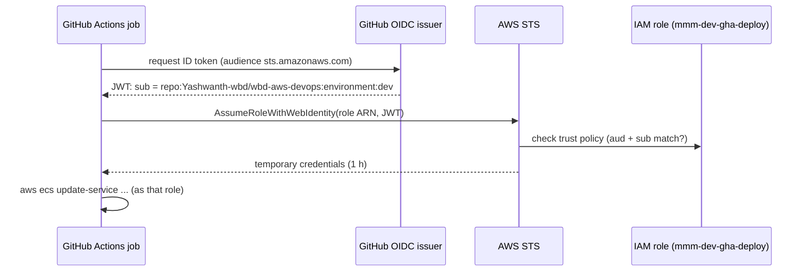

# 03 – How GitHub Actions logs in to AWS (OIDC, no stored keys)

GitHub Actions never stores AWS access keys. For each job, GitHub issues a signed
**OIDC token** that describes the repository, branch or tag, and GitHub Environment. AWS
checks the signature and the claims and hands back **temporary credentials** for one IAM
role, valid for one hour.

## 1. Flow



## 2. What gets created (Step 3, `iam-oidc` module)

In **each** AWS account:

| Resource | Value |
|---|---|
| IAM OIDC identity provider | URL `https://token.actions.githubusercontent.com`, audience `sts.amazonaws.com` |
| `mmm-<env>-gha-plan` | Read-only + read Terraform state. Used by `terraform plan` on pull requests |
| `mmm-<env>-gha-apply` | Terraform apply (bounded by the permission boundary) |
| `mmm-<env>-gha-deploy` | ECS rolling deploy (`api`, `ui`), run the `migrate` task, prod pre-migration RDS DB snapshot, read/write SageMaker image pointers `/mmm/<env_short>/images/*`, Lambda release (results publisher `live` alias), dry-run request to the run queue (dev, staging) |
| `mmm-<env>-gha-ecr-push` | Push images to **this account's** ECR registry. In dev it is used by CI builds; in staging and prod it receives the image copied during promotion |
| `mmm-<env>-gha-ecr-read` (dev and staging) | Pull images from this account's ECR, used as the copy source when promoting to the next environment |
| `mmm-<env>-gha-model-eval` (with data platform) | Read SageMaker Model Registry, evaluation objects in S3, tag packages, **Reject** failed versions; trust **`ref:refs/heads/main`** only |
| `mmm-<env>-gha-model-approve` (with data platform) | Same plus **Approve** and publish response curves to `s3://<models>/curves/<bu>/`; trust GitHub Environment **`<env>-model-promotion`** |

AWS no longer needs a certificate thumbprint for GitHub's OIDC provider (it uses its own
trusted CA list). Terraform still sends one value because the API field exists.

Model governance roles are created when `enable_data_platform = true` (same flag as
`enable_model_governance` on the OIDC module).

## 3. Trust policies (who may assume each role)

The `sub` claim decides **which repository and which GitHub Environment** may use a role.
When a job declares `environment: prod`, GitHub sets
`sub = repo:<org>/<repo>:environment:prod`, so only jobs that passed the prod approval gate
can assume the prod roles.

Prod deploy role trust policy (org/repo placeholders match dev tfvars until WBD changes them):

```json
{
  "Version": "2012-10-17",
  "Statement": [{
    "Effect": "Allow",
    "Principal": { "Federated": "arn:aws:iam::333333333333:oidc-provider/token.actions.githubusercontent.com" },
    "Action": "sts:AssumeRoleWithWebIdentity",
    "Condition": {
      "StringEquals": {
        "token.actions.githubusercontent.com:aud": "sts.amazonaws.com",
        "token.actions.githubusercontent.com:sub": "repo:Yashwanth-wbd/wbd-aws-devops:environment:prod"
      }
    }
  }]
}
```

| Role | Allowed `sub` values |
|---|---|
| `mmm-<env>-gha-plan` | `repo:<org>/<repo>:pull_request` (not prod), `repo:<org>/<repo>:environment:<env>`, `repo:<org>/<repo>:ref:refs/heads/main` (nightly drift check, no approval wait) |
| `mmm-<env>-gha-apply` | `repo:<org>/<repo>:environment:<env>` |
| `mmm-<env>-gha-deploy` | `repo:<org>/<repo>:environment:<env>` |
| `mmm-dev-gha-ecr-push` | `repo:<org>/<repo>:ref:refs/heads/main`, `…:environment:dev` |
| `mmm-stg-gha-ecr-push` / `mmm-prd-gha-ecr-push` | `…:environment:staging` / `…:environment:prod` |
| `mmm-dev-gha-ecr-read` / `mmm-stg-gha-ecr-read` | `…:environment:staging` / `…:environment:prod` (the next environment's promotion job) |
| `mmm-<env>-gha-model-eval` | `repo:<org>/<repo>:ref:refs/heads/main` |
| `mmm-<env>-gha-model-approve` | `repo:<org>/<repo>:environment:<env>-model-promotion` |

## 4. Data platform (Glue scripts, Databricks)

`glue.yml` uploads the Glue job scripts with the same **`mmm-<env>-gha-deploy`** role (environment
subject); with the data platform on, that role may `glue:GetJob` and put objects under
`scripts/` of the `glue-assets` bucket only. GitHub never talks to Databricks: the WBD export job
is deployed by WBD, and the **model-refresh** state machine starts it through the export Lambda
with the OAuth M2M service principal in Secrets Manager `mmm/<env>/databricks/export-sp` (filled
out of band—see [05-secrets-and-config.md](05-secrets-and-config.md)).

## 5. Using it in a workflow

```yaml
permissions:
  id-token: write      # allows the job to request the OIDC token
  contents: read

jobs:
  deploy-dev:
    runs-on: ubuntu-latest
    environment: dev   # sub becomes ...:environment:dev and dev approval rules apply
    steps:
      - uses: actions/checkout@v5
      - uses: aws-actions/configure-aws-credentials@v5
        with:
          role-to-assume: ${{ vars.AWS_DEPLOY_ROLE_ARN }}
          aws-region: ${{ vars.AWS_REGION }}
      - run: aws sts get-caller-identity
```

The workflows (Step 11) use major-version tags (`@v5`). If WBD policy requires it, pin them to
full commit SHAs and let Dependabot update them.

## 6. GitHub configuration (Step 11)

Role ARNs are **not secrets**; they are stored as GitHub Environment variables.
`scripts/setup-github.ps1` does all of this from the Terraform outputs (see
[09 section 4](09-cicd-pipelines.md#4-github-setup-once-per-environment-after-its-terraform-apply)).
Below is the manual equivalent.

```bash
# create the environments (approval rules are added in the GitHub UI or API)
gh api -X PUT repos/Yashwanth-wbd/wbd-aws-devops/environments/dev
gh api -X PUT repos/Yashwanth-wbd/wbd-aws-devops/environments/staging
gh api -X PUT repos/Yashwanth-wbd/wbd-aws-devops/environments/prod

# add actual value
gh variable set AWS_REGION          --env dev --body "us-east-1"
# add actual value
gh variable set AWS_DEPLOY_ROLE_ARN --env dev --body "arn:aws:iam::111111111111:role/mmm-dev-gha-deploy"
# add actual value
gh variable set TF_PLAN_ROLE_ARN    --env dev --body "arn:aws:iam::111111111111:role/mmm-dev-gha-plan"
# add actual value
gh variable set TF_APPLY_ROLE_ARN   --env dev --body "arn:aws:iam::111111111111:role/mmm-dev-gha-apply"
# add actual value
gh variable set ECR_PUSH_ROLE_ARN   --env dev --body "arn:aws:iam::111111111111:role/mmm-dev-gha-ecr-push"
# repeat for staging and prod with their own account IDs.
# staging and prod also get SOURCE_ECR_READ_ROLE_ARN + SOURCE_ECR_REGISTRY (the previous environment)

# repository level (no --env): PR plans, drift check, model-governance evaluate job
# add actual value
gh variable set TF_PLAN_ROLE_ARN_DEV --body "arn:aws:iam::111111111111:role/mmm-dev-gha-plan"
# when enable_data_platform = true (from terraform output github_repository_variables):
# gh variable set MODEL_EVAL_ROLE_ARN_DEV --body "arn:aws:iam::111111111111:role/mmm-dev-gha-model-eval"
# gh variable set MODEL_APPROVE_ROLE_ARN_DEV --body "arn:aws:iam::111111111111:role/mmm-dev-gha-model-approve"
# gh variable set MODELS_BUCKET_DEV --body "wbd-mmm-dev-models-use1"
```

The values come from the `terraform output` of each environment after Step 3.

## 7. How the pipelines use it end to end

| Trigger | GitHub Environment | Roles assumed |
|---|---|---|
| Pull request touching `infra/**` | none (repository variable `TF_PLAN_ROLE_ARN_<ENV>`) | `mmm-dev-gha-plan`, `mmm-stg-gha-plan` (prod is never planned from PR code) |
| Merge to `main` (infra) | `dev` → `staging` → `prod` (approvals between) | `mmm-<env>-gha-apply` |
| Merge to `main` (app) | build job, then `dev` | `mmm-dev-gha-ecr-push`, then `mmm-dev-gha-deploy` |
| Tag `vX.Y.Z-rcN` | `staging` (EY lead approves) | `mmm-dev-gha-ecr-read` → `mmm-stg-gha-ecr-push` (copy image), `mmm-stg-gha-deploy` |
| Tag `vX.Y.Z` | `prod` (WBD approver + change ticket) | `mmm-stg-gha-ecr-read` → `mmm-prd-gha-ecr-push` (copy image), `mmm-prd-gha-deploy` |
| Nightly drift check | none (runs on `main`) | `mmm-<env>-gha-plan` |
| `model-governance.yml` evaluate (hourly / dispatch) | none | `mmm-<env>-gha-model-eval` |
| `model-governance.yml` promote / rollback | `<env>-model-promotion` | `mmm-<env>-gha-model-approve` |

## 8. Validate OIDC after Step 3

1. Run a manual workflow with the `dev` environment that only calls
   `aws sts get-caller-identity`. It must print the `mmm-dev-gha-plan` role.
2. Run the same job without `environment:` from a feature branch. Assuming the deploy role
   must fail with `Not authorized to perform sts:AssumeRoleWithWebIdentity`.
3. In CloudTrail, the `AssumeRoleWithWebIdentity` event shows the repository and
   environment in the `sub` field.
