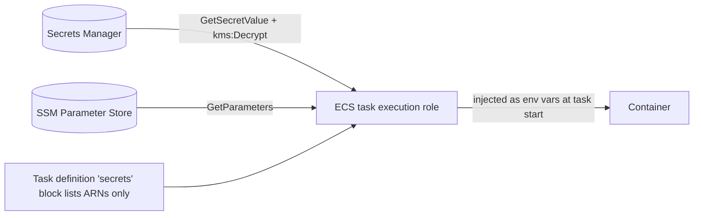

# 05 – Secrets and configuration: where everything lives

## 1. Decision table

| Kind of value | Store | Examples | Why |
|---|---|---|---|
| Passwords, tokens, keys | **AWS Secrets Manager** (KMS key `alias/mmm-<env>-secrets`) | DB app user, Redis auth token, Databricks token, Splunk HEC token | Encrypted, audited, rotatable, injected into ECS at start |
| Non-secret runtime settings | **SSM Parameter Store** (`String`, or `SecureString` if sensitive) | `genai_enabled`, Okta issuer, quotas, endpoints | Change without redeploying code |
| Non-secret pipeline settings | **GitHub Environment variables** | role ARNs, region, cluster name, subnet IDs | Not secret; scoped per environment |
| Pipeline secrets | **GitHub Environment secrets** (rare) | `SONAR_TOKEN` if SonarQube is used | Only for third-party tools that cannot use OIDC |
| AWS credentials for pipelines | **none stored** | – | GitHub OIDC gives temporary credentials |
| Values generated by Terraform | Terraform state (S3, KMS-encrypted, versioned, restricted) + copied into Secrets Manager | Redis auth token, CloudFront `X-Origin-Verify` value | Never typed by a human, never in Git |
| RDS admin password | **RDS-managed secret** (Secrets Manager, auto-rotated) | `rds!db-xxxx` | Nobody ever sees it |

**Never:** in Git, in Docker images, in plain task-definition `environment`, in Terraform
variables or tfvars, in GitHub variables, in logs.

## 2. Secret names (Step 5 creates empty containers)

| Secret | Contents | Created / filled by | Read by |
|---|---|---|---|
| `mmm/<env>/api/db` | `{host, port, dbname, username}` + password | Terraform (container) / DevOps after first migration | API, workers |
| `mmm/<env>/rds/proxy` | app DB user `{username, password}` (never the admin) | DevOps after first migration | RDS Proxy |
| `mmm/<env>/rds/migrate` | migration DB user `{username, password}` (schema owner) | DevOps at first-time DB setup | RDS Proxy (migrate task logs in with an IAM token) |
| `mmm/<env>/redis/token` | Redis auth token | Terraform (`random_password`) | API, workers |
| `mmm/<env>/edge/origin-verify` | CloudFront → ALB shared header value | Terraform (`random_password`) | CloudFront, ALB rule |
| `mmm/<env>/databricks/sp` | Databricks service-principal token | DevOps from WBD Databricks admins | Workers (MLflow model load) |
| `mmm/<env>/airflow/connections/databricks_default` | Airflow connection JSON `{conn_type, host, login, password, extra}` for the MWAA service principal (OAuth secret). Only with `enable_data_platform` | WBD Databricks admin ([docs/10 §5](10-data-platform-and-model-governance.md#5-secrets-and-settings)) | MWAA (Secrets Manager backend, prefix `mmm/<env>/airflow/connections`) |
| `mmm/<env>/splunk/hec` | Splunk HEC token as `{"hec_token":"..."}` (Firehose requires this key name) | DevOps from WBD Splunk team | Firehose reads it directly; it is never a Terraform variable (Step 9) |
| `mmm/<env>/thirdparty/<vendor>` | API keys (e.g. Adstra, Inscape) | DevOps from WBD data owners | MWAA / Databricks jobs |

## 3. SSM parameters

| Parameter | Example | Read by |
|---|---|---|
| `/mmm/<env>/genai_enabled` | `false` | API |
| `/mmm/<env>/okta/issuer` | `https://wbd.okta.com/oauth2/aus0000000000000000` | API, frontend build |
| `/mmm/<env>/okta/client_id` | `0oa00000000000000000` | frontend build |
| `/mmm/<env>/okta/audience` | `api://mmm-dev` | API |
| `/mmm/<env>/databricks/host` | `https://dbc-00000000-0000.cloud.databricks.com` | Workers, MWAA |
| `/mmm/<env>/databricks/sql_http_path` | `/sql/1.0/warehouses/0000000000000000` | Workers |
| `/mmm/<env>/genai/token_quota/<bu>` | `1000000` | GenAI gateway (R2) |
| `/mmm/<env>/genai/{model_id,guardrail_id,guardrail_version}` | – | GenAI gateway (R2) |

## 4. How a value gets into a running container



Task definition fragment (Step 7 writes the real one):

```json
"secrets": [
  { "name": "REDIS_AUTH_TOKEN", "valueFrom": "arn:aws:secretsmanager:<region>:<account>:secret:mmm/dev/redis/token" },
  { "name": "GENAI_ENABLED",    "valueFrom": "arn:aws:ssm:<region>:<account>:parameter/mmm/dev/genai_enabled" }
]
```

- The **execution role** may read only the secrets listed for that service.
- The **task role** (the app's own identity) gets no Secrets Manager access unless the app
  reads secrets itself at runtime.
- After rotating a secret, force a new deployment so tasks pick it up:
  `aws ecs update-service --cluster mmm-dev-ecs --service mmm-dev-api --force-new-deployment`

## 5. Filling a secret (DevOps engineer, through SSO)

Use a file so the value doesn't end up in shell history, then delete the file:

```powershell
$env:AWS_PROFILE = "mmm-dev-devops"
aws secretsmanager put-secret-value --secret-id mmm/dev/databricks/sp --secret-string file://sp.json
Remove-Item sp.json
aws secretsmanager describe-secret --secret-id mmm/dev/databricks/sp --query "LastChangedDate"
```

Changing a setting: SSM parameter values are owned by Terraform. A manual `put-parameter`
would be reverted on the next apply, so change the value in
`infra/environments/<env>/terraform.tfvars` (for example `genai_enabled = true`) through a pull
request and apply it. Then force a new ECS deployment, because tasks read parameters at start.

```powershell
terraform plan -out=cfg.tfplan     # shows only the aws_ssm_parameter change
terraform apply cfg.tfplan
aws ssm get-parameter --name /mmm/dev/genai_enabled --query Parameter.Value
```

## 6. Rotation

| Secret | Rotation |
|---|---|
| RDS admin | Automatic (RDS-managed, 7 days) |
| App DB user | Rotation Lambda (alternating users) – Step 5 follow-up, or every 90 days manually |
| Redis token / origin-verify | Change `generated_secret_rotation_id` in tfvars and apply; ElastiCache supports two tokens during the switch |
| Databricks / Splunk / third-party | When the issuer rotates; update the secret and force a new deployment |

## 7. Guard rails

- **Trivy secret scan** (`repo-checks.yml`, the same rules as `scripts/secret-scan.ps1`) on every pull request blocks committed secrets. Turn on GitHub secret scanning push protection too, if licensed.
  Locally, run `.\scripts\secret-scan.ps1` (Trivy).
- **Checkov** fails on hard-coded credentials in Terraform.
- **CloudWatch Logs data-protection policy** masks credentials and personal data in logs.
- **Terraform state** holds generated secrets, so the state bucket is KMS-encrypted,
  versioned, has public access blocked, and only the `gha-plan` / `gha-apply` roles and the
  DevOps permission set can read it.
