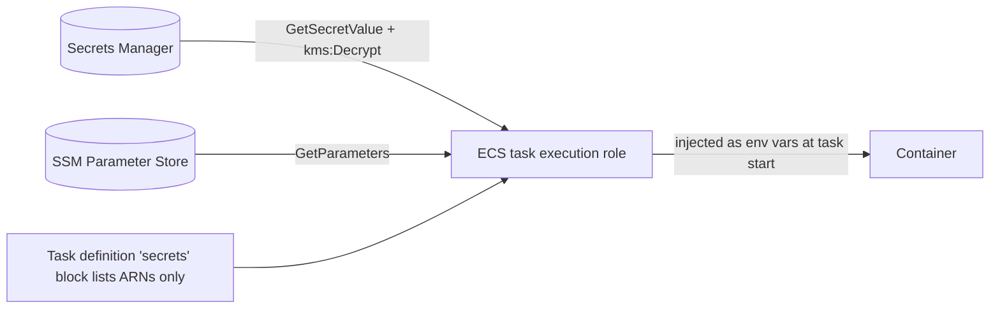

# 05 – Secrets and configuration: where everything lives

## 1. Decision table

| Kind of value | Store | Examples | Why |
|---|---|---|---|
| Passwords, tokens, keys | **AWS Secrets Manager** (KMS key `alias/mmm-<env>-secrets`) | DB app user, Okta OIDC client secret (ALB), Splunk HEC token, third-party API keys, LLM provider keys | Encrypted, audited, rotatable, injected into ECS at start |
| Non-secret runtime settings | **SSM Parameter Store** (`String`, or `SecureString` if sensitive) | `genai_enabled`, Okta issuer, run concurrency limit, Databricks host, GenAI quotas | Change via Terraform tfvars + apply |
| Non-secret pipeline settings | **GitHub Environment variables** | role ARNs, region, cluster name, subnet IDs, `APP_URL` | Not secret; scoped per environment |
| Pipeline secrets | **GitHub Environment secrets** (rare) | `SONAR_TOKEN` if SonarQube is used | Only for third-party tools that cannot use OIDC |
| AWS credentials for pipelines | **none stored** | – | GitHub OIDC gives temporary credentials |
| Databricks SP secret (model refresh) | **EventBridge connection** auth (managed secret ARN on the connection) | OAuth client secret for `databricks_sp_client_id` | Terraform creates placeholder `set-out-of-band`; DevOps updates once |
| RDS admin password | **RDS-managed secret** (Secrets Manager, auto-rotated) | `rds!db-…` | Nobody ever sees it |

**Never:** in Git, in Docker images, in plain task-definition `environment`, in Terraform
variables or tfvars (for secret **values**), in GitHub variables, in logs.

## 2. Secret names (Step 5 creates empty containers)

All paths use prefix **`mmm/<env_short>/`** (for example `mmm/dev/api/db` in the dev account).

| Secret | Contents | Created / filled by | Read by |
|---|---|---|---|
| `mmm/<env>/api/db` | `{host, port, dbname, username, password}` | DevOps after first migration / bootstrap | API (`migrate` uses `rds/migrate`) |
| `mmm/<env>/rds/proxy` | app DB user `{username, password}` (never the admin) | DevOps after first migration | RDS Proxy (app user) |
| `mmm/<env>/rds/migrate` | migration DB user `{username, password}` (schema owner) | DevOps at first-time DB setup | Migrate task (via RDS Proxy + IAM auth) |
| `mmm/<env>/okta/alb-client` | `{"client_secret":"..."}` of the Okta OIDC Web app (`okta_client_id`) | DevOps from WBD Identity, before `okta_sign_in_enabled = true` | Terraform (data source, only with `okta_sign_in_enabled`) → ALB listener `authenticate-oidc` |
| `mmm/<env>/splunk/hec` | `{"hec_token":"..."}` (Firehose requires this key name) | DevOps from WBD Splunk team | Firehose (when `enable_splunk_shipping`) |
| `mmm/<env>/thirdparty/<vendor>` | Vendor-specific JSON (e.g. API keys) | DevOps from WBD data owners | API / batch jobs as wired by the app |
| `mmm/<env>/llm/<provider>` | `{"api_key":"..."}` (only when `enable_genai`) | DevOps from WBD / vendor | LLM gateway proxy Lambda |

There is **no** `redis/token`, **no** `edge/origin-verify`, **no** `databricks/sp` Secrets Manager
entry, and **no** MWAA connection secrets in v2.

## 3. SSM parameters (Terraform-owned values)

| Parameter | Example | Set from | Read by |
|---|---|---|---|
| `/mmm/<env>/genai_enabled` | `false` | tfvars `genai_enabled` | API |
| `/mmm/<env>/okta/issuer` | `https://wbd.okta.com/oauth2/default` | tfvars `okta_issuer` | API (also env `OKTA_ISSUER`) |
| `/mmm/<env>/optimization/max_concurrent_runs` | `5` | tfvars `max_concurrent_runs` (change it there, not in the console) | Run dispatcher Lambda (each batch) |
| `/mmm/<env>/databricks/host` | `https://dbc-….cloud.databricks.com` | tfvars `databricks_host` | Platform jobs / diagnostics |
| `/mmm/<env>/genai/token_quota/<bu>` | `1000000` | tfvars `genai_token_quotas` | LLM gateway (Release 2) |

SageMaker image pointers live under **`/mmm/<env_short>/images/`** (separate parameters, written
by `deploy.yml`—not in the secrets module).

## 4. EventBridge connection: Databricks OAuth secret (model refresh)

When `enable_data_platform = true`, Terraform creates connection
**`<prefix>-databricks`** (dev: `mmm-dev-databricks`) with client ID
`databricks_sp_client_id` and placeholder client secret `set-out-of-band`. DevOps sets the
real **service principal OAuth secret** once (WBD Databricks admin):

```powershell
$env:AWS_PROFILE = "mmm-dev-devops"
$conn = "mmm-dev-databricks"   # terraform output data_platform.databricks_connection
$id   = "00000000-0000-0000-0000-00000000c001"  # add actual value - databricks_sp_client_id
$secret = Read-Host "Databricks SP client secret" -AsSecureString
$bstr = [Runtime.InteropServices.Marshal]::SecureStringToBSTR($secret)
$plain = [Runtime.InteropServices.Marshal]::PtrToStringAuto($bstr)

aws events update-connection `
  --name $conn `
  --authorization-type OAUTH_CLIENT_CREDENTIALS `
  --auth-parameters "OAuthParameters={ClientParameters={ClientID=$id,ClientSecret=$plain},AuthorizationEndpoint=https://dbc-00000000-0000.cloud.databricks.com/oidc/v1/token,HttpMethod=POST,OAuthHttpParameters={BodyParameters=[{Key=grant_type,Value=client_credentials,IsValueSecret=false},{Key=scope,Value=all-apis,IsValueSecret=false}]}}"

# add actual value - use databricks_host from tfvars (no trailing slash) in AuthorizationEndpoint
```

Replace `AuthorizationEndpoint` with `{databricks_host}/oidc/v1/token` for that environment.
Terraform ignores changes to the client secret after the first manual update
(`lifecycle { ignore_changes = … }` on the connection).

## 5. How a value gets into a running container



Example API task secrets (from Terraform): `GENAI_ENABLED` from SSM; DB credentials from Secrets
Manager when wired after bootstrap. Plain environment: `OKTA_ISSUER`, `OPTIMIZATION_QUEUE_URL`.

- The **execution role** may read only the secrets listed for that service.
- The **task role** (the app's own identity) gets no Secrets Manager access unless the app
  reads secrets itself at runtime.
- After rotating a secret, force a new deployment so tasks pick it up:
  `aws ecs update-service --cluster mmm-dev-ecs --service mmm-dev-api --force-new-deployment`

## 6. Filling a secret (DevOps engineer, through SSO)

Use a file so the value doesn't end up in shell history, then delete the file:

```powershell
$env:AWS_PROFILE = "mmm-dev-devops"
aws secretsmanager put-secret-value --secret-id mmm/dev/splunk/hec --secret-string file://hec.json
Remove-Item hec.json
aws secretsmanager describe-secret --secret-id mmm/dev/splunk/hec --query "LastChangedDate"
```

LLM provider key (Release 2, after `enable_genai = true`):

```powershell
aws secretsmanager put-secret-value --secret-id mmm/dev/llm/openai --secret-string '{"api_key":"..."}'
```

Changing a non-secret flag: update `infra/environments/<env>/terraform.tfvars` (for example
`genai_enabled = true`) through a pull request and apply. Then force a new ECS deployment,
because tasks read parameters at start.

```powershell
terraform plan -out=cfg.tfplan
terraform apply cfg.tfplan
aws ssm get-parameter --name /mmm/dev/genai_enabled --query Parameter.Value
```

## 7. Rotation

| Secret | Rotation |
|---|---|
| RDS admin | Automatic (RDS-managed) |
| Okta ALB client secret | When WBD Identity rotates it: `put-secret-value` on `okta/alb-client`, then `terraform apply` (the listener gets the new value; [runbooks/rotation.md](runbooks/rotation.md)) |
| App / migrate DB users | Manual or rotation Lambda follow-up; update Secrets Manager and redeploy |
| Splunk / third-party / LLM keys | When the issuer rotates; update the secret and force a new deployment |
| Databricks connection OAuth secret | WBD rotates SP secret; re-run `aws events update-connection` with the new `ClientSecret` |

## 8. Guard rails

- **Trivy secret scan** (`repo-checks.yml`, the same rules as `scripts/secret-scan.ps1`) on every pull request blocks committed secrets. Turn on GitHub secret scanning push protection too, if licensed.
  Locally, run `.\scripts\secret-scan.ps1` (Trivy).
- **Checkov** fails on hard-coded credentials in Terraform.
- **CloudWatch Logs data-protection policy** masks credentials and personal data in logs.
- **Terraform state** may reference secret metadata, and holds the Okta ALB client secret (the listener needs it); the state bucket is KMS-encrypted,
  versioned, has public access blocked, and only the `gha-plan` / `gha-apply` roles and the
  DevOps permission set can read it.
