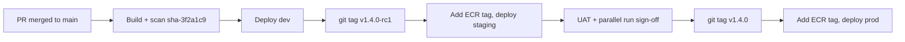

# 07 – Branching, release tags and promotion

## 1. Branching (trunk-based)

| Branch | Purpose | Rules |
|---|---|---|
| `main` | Always releasable; every merge deploys to dev | Protected: PR required, 1–2 reviewers, all checks green, no force-push, linear history |
| `feature/<ticket>-<desc>` | New work | Short-lived, squash-merged |
| `fix/…`, `chore/…`, `infra/…` | Fixes, housekeeping, infrastructure | Same as feature |

There are no long-lived `develop` or per-environment branches. Environments are selected by
**tags**, not by branches.

CODEOWNERS (`infra/**`, `.github/**`, `ecs/**` → DevOps team) is deferred until WBD names the
teams.

## 2. Tags and where they go

| Tag | Created by | Deploys to | Approval |
|---|---|---|---|
| `sha-<7char>` (image tag) | CI on every merge to `main` | dev | automatic |
| `vX.Y.Z-rcN` (git tag) | Release manager | staging (UAT, parallel run) | EY delivery lead |
| `vX.Y.Z` (git tag, annotated, message contains the change ticket) | Release manager after UAT sign-off, on the **same commit** as the approved rc | prod | WBD approver + CAB change ticket, prevent self-review |
| `data-vX.Y.Z` | Data team lead | MWAA DAGs dev → staging → prod | same gates |

The **same image** moves through all environments. The pipeline adds the `vX.Y.Z-rcN` and
`vX.Y.Z` tags to the already-scanned `sha-…` image in ECR; nothing is rebuilt. ECR tag
immutability prevents a tag from ever pointing to a different image.

## 3. Deploy sequence (every environment)

1. Remember the currently running task-definition revision (for rollback).
2. Prod only: take an RDS snapshot.
3. Run database migrations as a one-off ECS task (`mmm-<env>-migrate`) and check its exit code.
4. Register new task-definition revisions with the new image tag.
5. Update each ECS service and wait for it to become stable.
6. Smoke test `/api/health` through CloudFront.
7. If the smoke test fails, roll back to the remembered revision.
8. Record tag, revision and image digest in the release notes.

## 4. Rollback options

| What | How |
|---|---|
| App (automatic) | ECS deployment circuit breaker rolls back failed deployments |
| App (manual) | `aws ecs update-service --cluster mmm-<env>-ecs --service mmm-<env>-api --task-definition mmm-<env>-api:<previous>` or re-run deploy with the previous tag |
| Frontend | `scripts/deploy-frontend.sh switch <kvs-arn> <previous release>` (key `current_release`) |
| Infrastructure | Revert the PR, merge, pipeline applies |
| Model | Move the MLflow `production` alias back |
| GenAI | Set `/mmm/<env>/genai_enabled` to `false` |
| Database | Migrations are expand-then-contract, so the previous app version still works; restore from snapshot only as a last resort |

Every rollback path is rehearsed in staging before go-live. The pipeline commands are in
[09 section 6](09-cicd-pipelines.md#6-everyday-operations).
