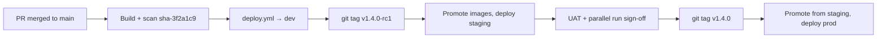

# 07 – Branching, release tags and promotion

## 1. Branching (trunk-based)

| Branch | Purpose | Rules |
|---|---|---|
| `main` | Always releasable; every merge deploys to dev | Protected: PR required, 1–2 reviewers, all checks green, no force-push, linear history |
| `feature/<ticket>-<desc>` | New work | Short-lived, squash-merged |
| `fix/…`, `chore/…`, `infra/…` | Fixes, housekeeping, infrastructure | Same as feature |

There are no long-lived `develop` or per-environment branches. Environments are selected by
**tags** and **GitHub Environments**, not by branches.

CODEOWNERS (`infra/**`, `.github/**`, `ecs/**` → DevOps team) is deferred until WBD names the
teams.

## 2. Tags and where they go

| Tag / trigger | Created by | Deploys to | Approval |
|---|---|---|---|
| `sha-<7char>` (ECR image tag) | CI on every merge to `main` | dev (via `deploy.yml` after CI) | automatic |
| `vX.Y.Z-rcN` (git tag) | Release manager | staging (UAT, parallel run) | EY delivery lead |
| `vX.Y.Z` (git tag, annotated, message contains the change ticket) | Release manager after UAT sign-off, on the **same commit** as the approved rc | prod | WBD approver + CAB change ticket, prevent self-review |

**Application releases** use only `v*` tags above. There are no `data-v*` tags and no
`data.yml` pipeline.

**Separate tracks** (same repo, different workflows):

| Track | Workflow | Promotion |
|---|---|---|
| Databricks bundle (`data/databricks/databricks.yml`) | `databricks.yml` | `main` → dev; manual dispatch → staging/prod (GitHub Environment approval). Skipped while `data/databricks/` is absent |
| Model packages (SageMaker Model Registry) | `model-governance.yml` | Hourly/dispatch evaluate on `main`; human approve in `<env>-model-promotion`. Not tied to `v*` tags—see [10 §7](10-data-platform-and-model-governance.md#7-model-governance-model-governanceyml) |

The **same container image digest** moves through dev → staging → prod for `api` and `ui`.
SageMaker images are referenced by digest in SSM (`/mmm/<env_short>/images/sagemaker-*`).
The publisher Lambda ships as a zip (new version + alias `live`). ECR tag immutability prevents
a tag from ever pointing at a different digest.

## 3. Deploy sequence (every environment)

Handled by `deploy.yml` ([09 §3](09-cicd-pipelines.md#3-deploy-sequence-deployyml-one-job-after-the-approval)):

1. Remember the currently running task-definition revision (and SSM pointers / Lambda alias) for rollback.
2. **Prod only** (when migrations run with `api`): RDS DB snapshot `mmm-<env>-predeploy-<version>-<run>`.
3. Run database migrations as a one-off ECS task (`mmm-<env>-migrate`) when `api` is in scope.
4. Register new task-definition revisions for `api` and/or `ui` with the new image.
5. Update ECS services and wait for stable (deployment circuit breaker).
6. Smoke test `APP_URL`: `/api/health` → 200; `/` → 302 to Okta (`smoke.sh`, once sign-in is on).
7. Update SageMaker image SSM pointers and/or publish the results-publisher Lambda.
8. If any step fails after ECS deploy started, roll back ECS, SSM pointers and Lambda alias.
9. Record version, digests, revisions and snapshot in the release record artifact.

## 4. Rollback options

| What | How |
|---|---|
| App (automatic) | ECS deployment circuit breaker rolls back failed `api` / `ui` deployments |
| App (manual) | Re-run `deploy.yml` with `run_migrations=false` and a previous `image_tag`, or `aws ecs update-service … --task-definition mmm-<env>-api:<previous>` (break-glass) |
| SageMaker images | `deploy.yml` rollback restores previous SSM parameter values; running Step Functions executions keep the image they started with |
| Results publisher | `lambda-release.sh switch` or failed deploy rollback moves alias `live` to the previous version |
| Infrastructure | Revert the PR, merge, `terraform.yml` applies |
| Model curves | `model-governance.yml` rollback (re-publish previous approved curves and drift baseline)—[runbooks/model-rollback.md](runbooks/model-rollback.md) |
| GenAI | Set SSM `/mmm/<env_short>/genai_enabled` to `false` |
| Database | Migrations are expand-then-contract, so the previous app version still works; restore from PITR or snapshot only as a last resort—[08 §3](08-backup-and-dr.md#3-restore-the-rds-database-to-a-point-in-time) |

Every rollback path is rehearsed in staging before go-live. Pipeline commands are in
[09 section 6](09-cicd-pipelines.md#6-everyday-operations).
