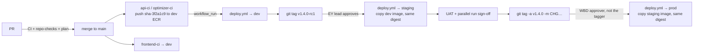

# 09 – CI/CD pipelines (GitHub Actions)

Everything reaches AWS through GitHub Actions with OIDC ([03](03-github-oidc.md)). Nobody deploys
or applies Terraform from a laptop after this step. No AWS keys or app secrets are stored in GitHub.

## 1. The workflows

| Workflow | Trigger | What it does |
|---|---|---|
| `api-ci.yml`, `optimizer-ci.yml` | PR or push to `main` touching `apps/api/**` / `apps/optimizer-worker/**` | Calls `_python-service-ci.yml`: ruff lint + format check, mypy, pytest with a **coverage gate (80 %)**, Trivy dependency audit, Docker build, **Trivy image scan** (fixable Critical/High block). On `main` it pushes `mmm/<app>:sha-<7char>` to the dev ECR |
| `frontend-ci.yml` | PR or push to `main` touching `apps/frontend/**` | `npm ci`, lint, tests, build, Trivy audit. On `main` it publishes release `sha-<7char>` to dev and switches CloudFront to it |
| `deploy.yml` | a CI run on `main` finished, a `v*` tag, or manual | Promote image → (prod) RDS snapshot → migration task → new task definitions → wait for stable → smoke test → frontend (releases) → release record. Rolls back on any failure |
| `terraform.yml` | PR / push touching `infra/**`, nightly 03:00 UTC, manual | PR: fmt, validate, tflint, Checkov, plan dev + staging. `main`: apply dev → staging → prod (approvals). Nightly: drift check |
| `repo-checks.yml` | every PR and push to `main` | Trivy secret scan, Semgrep SAST on `apps/`, shellcheck, LF line endings, actionlint, ECS template check |
| `data.yml` | PR / push to `main` touching `data/**`, tags `data-v*`, manual | PR: ruff, Airflow DAG import test, manifest schema, thresholds. `main` → dev, `data-vX.Y.Z-rcN` → staging, `data-vX.Y.Z` → prod: `requirements.txt` (MWAA update only if changed), DAGs, quality suites, `release.json` ([docs/10 §6](10-data-platform-and-model-governance.md#6-releasing-dags-datayml)) |
| `model-governance.yml` | hourly, manual | Evaluates new `candidate` model versions against `data/model-thresholds.yaml`; passing ones wait for a WBD approver in `<env>-model-promotion`, then the `production` alias moves. Manual promote / rollback ([docs/10 §7](10-data-platform-and-model-governance.md#7-model-governance-model-governanceyml)) |
| `_python-service-ci.yml`, `_terraform-apply.yml` | called by the workflows above | Shared steps |

| `genai-ci.yml` (Release 2) | PR or push to `main` touching `apps/genai-gateway/**` | Same `_python-service-ci.yml` steps for the GenAI gateway; pushes `mmm/genai-gateway:sha-<7char>` to the dev ECR. `deploy.yml` rolls it out only where the Environment variable `GENAI_ENABLED` is `true` ([docs/12](12-genai-bedrock.md)) |

## 2. How a change reaches production



- **Dev** deploys only the component that was built. An `api-ci` run deploys `api` and runs the
  migration. An `optimizer-ci` run deploys `whatif-worker` and `optimizer-worker`. A `genai-ci`
  run deploys `genai-gateway`, or only logs a notice while `GENAI_ENABLED` is not `true`.
- **Release tags** deploy `api`, the workers and (where `GENAI_ENABLED` is `true`) `genai-gateway`.
  Turn GenAI on in staging before prod: prod copies the gateway image from the staging rc.
- **Staging**: for each app, `promote-images.sh find-build` picks the newest dev image built from
  the tagged commit or one of its ancestors. It fails if the app folder changed after that build
  (for example, the CI run on `main` failed), so a stale image is never promoted.
- **Prod** needs a `vX.Y.Z-rcN` tag on **the same commit**: it copies that exact staging image. The
  tag must be annotated, and its message must contain the change ticket (`CHANGE_TICKET_PATTERN`,
  default `CHG` + 7 digits).
- Images keep their digest when they are copied (`skopeo copy --preserve-digests`). ECR tags are
  immutable, so `v1.4.0` can never point to a different image.

## 3. Deploy sequence (deploy.yml, one job after the approval)

1. **Promote** (tags only): log in to the previous environment's ECR with its `gha-ecr-read` role.
   Then log in to this environment's ECR with `gha-ecr-push` and copy the images.
2. Switch to `gha-deploy`. Check that the images exist and note the **running revision** of each service.
3. **Prod:** `aws rds create-db-snapshot` `mmm-prd-predeploy-<version>-<run>` and wait for it.
4. **Migration:** register `mmm-<env>-migrate` with the new API image and run it once
   (`run-migration.sh`). The job prints the task log and stops if the exit code is not 0.
5. **Services:** `ecs-deploy.sh render` takes the latest Terraform revision of the family, overlays
   `ecs/<env>/<service>.json`, and sets the image and `APP_VERSION`. `ecs-deploy.sh update` then
   waits for `rolloutState = COMPLETED`. If the circuit breaker rolls back, the step fails.
6. **Smoke test** `<APP_URL>/api/health` through CloudFront (`smoke.sh`, 12 × 10 s).
7. **Frontend** (tags): upload `releases/<version>/` and write `config.json` (Okta settings from
   SSM). Then set `current_release` and check that `/` returns 200.
8. **Rollback** on failure: services go back to the revisions from step 2 and the frontend goes back
   to the previous release. Migrations are **not** reverted, because they are expand-then-contract.
9. **Release record:** environment, version, commit, image digests, task-definition revisions,
   who triggered it, **who approved** (GitHub approvals API), change ticket and snapshot. It goes
   to the job summary and the `release-record-*` artifact (90 days). GitHub's deployment history
   per environment also keeps the approver.

### Who owns what in a task definition

| Owner | Fields | Where |
|---|---|---|
| Terraform | roles, CPU and memory, environment variables, secrets (ARNs only), logging, volumes, sidecars | `infra/environments/<env>/ecs.tf` |
| App team (via DevOps review) | `command`, `entryPoint`, `stopTimeout` of the `app` container | `ecs/<env>/<service>.json` |
| Pipeline | `image`, `APP_VERSION` | `deploy.yml` |

A Terraform change to a task definition, such as a new environment variable, creates a new
revision, but the running services don't use it yet. Run `deploy.yml` manually with the current
image to roll it out.

## 4. GitHub setup (once per environment, after its `terraform apply`)

### 4.1 Environments, protection and variables

`scripts/setup-github.ps1` creates the environment, its protection rules and all variables from the
Terraform outputs:

```powershell
gh auth login
# add actual value (org/repo)
.\scripts\setup-github.ps1 -Repo wbd-org/wbd-mmm-platform -Environment dev
# Step 12, once the stacks exist (add actual value: teams and account IDs)
.\scripts\setup-github.ps1 -Repo wbd-org/wbd-mmm-platform -Environment staging -ReviewerTeams ey-delivery-leads `
  -SourceEcrReadRoleArn arn:aws:iam::111111111111:role/mmm-dev-gha-ecr-read -SourceEcrRegistry 111111111111.dkr.ecr.us-east-1.amazonaws.com
.\scripts\setup-github.ps1 -Repo wbd-org/wbd-mmm-platform -Environment prod -ReviewerTeams wbd-release-approvers `
  -SourceEcrReadRoleArn arn:aws:iam::222222222222:role/mmm-stg-gha-ecr-read -SourceEcrRegistry 222222222222.dkr.ecr.us-east-1.amazonaws.com
# Step 13, once WBD names the model approvers (add actual value: teams); -SkipVariables keeps the rest
.\scripts\setup-github.ps1 -Repo wbd-org/wbd-mmm-platform -Environment prod -ReviewerTeams wbd-release-approvers `
  -ModelApproverTeams wbd-model-approvers -SkipVariables
```

| Environment | Required reviewers | Prevent self-review | Allowed refs |
|---|---|---|---|
| `dev` | none | – | `main` |
| `staging` | EY delivery lead(s) | no | `main` (Terraform), tags `v*`, `data-v*` |
| `prod` | WBD approver(s); CAB ticket in the tag | **yes** | `main` (Terraform), tags `v*`, `data-v*`; deploy.yml also refuses anything but `vX.Y.Z` |
| `<env>-model-promotion` (Step 13) | WBD model approver(s) (`-ModelApproverTeams/-Users`) | **yes** | `main` |

**Environment variables** (non-secret, from `terraform output github_environment_variables`):

| Variable | Used by |
|---|---|
| `AWS_REGION` | all |
| `TF_PLAN_ROLE_ARN`, `TF_APPLY_ROLE_ARN` | terraform |
| `AWS_DEPLOY_ROLE_ARN` | deploy, frontend |
| `ECR_PUSH_ROLE_ARN`, `ECR_REGISTRY` | CI push (dev), promotion target (staging/prod) |
| `ECS_CLUSTER`, `APP_SUBNET_IDS`, `DATA_CLIENTS_SG_ID` | deploy, migration |
| `APP_URL`, `CLOUDFRONT_DISTRIBUTION_ID`, `FRONTEND_BUCKET`, `FRONTEND_KVS_ARN` | smoke test, frontend |
| `SOURCE_ECR_READ_ROLE_ARN`, `SOURCE_ECR_REGISTRY` | staging/prod promotion (the previous environment) |
| `MWAA_BUCKET`, `MWAA_ENVIRONMENT`, `QUALITY_BUCKET` | data.yml (only when `enable_data_platform`; if they are missing, the publish job is skipped) |

**Optional environment variables:**

| Variable | Default | Purpose |
|---|---|---|
| `SMOKE_BASE_URL` | `APP_URL` | Use the CloudFront domain (`https://dxxxx.cloudfront.net`) until WBD DNS exists |
| `SMOKE_CHECK_VERSION` | off | `true` once `/api/health` returns `APP_VERSION`, so the smoke test proves the new version answers |
| `CHANGE_TICKET_PATTERN` | `CHG[0-9]{7}` | Regex for the change ticket in the prod tag message |

**Repository variables** (no environment, from `terraform output github_repository_variables`):
`AWS_REGION` and `TF_PLAN_ROLE_ARN_DEV` / `_STAGING` / `_PROD`. PR plans and the nightly drift
check use them, because those jobs have no environment. If a variable is missing, the plan for
that environment is skipped with a notice. With the data platform enabled, `model-governance.yml`
also gets `DATABRICKS_HOST_<ENV>`, `DATABRICKS_EVAL_CLIENT_ID_<ENV>`,
`DATABRICKS_PROMOTE_CLIENT_ID_<ENV>` and `MODEL_CATALOG_<ENV>`. They are IDs, not secrets: GitHub
OIDC federation replaces Databricks tokens.

**GitHub secrets:** none. Add only scanner tokens if WBD uses SonarQube or similar.

### 4.2 Branch protection on `main` (repo admin)

```powershell
# add actual value (org/repo)
$body = @'
{
  "required_status_checks": { "strict": true, "contexts": ["secret-scan", "sast", "lint"] },
  "enforce_admins": true,
  "required_pull_request_reviews": { "required_approving_review_count": 1, "dismiss_stale_reviews": true },
  "restrictions": null,
  "required_linear_history": true,
  "allow_force_pushes": false,
  "allow_deletions": false
}
'@
$body | gh api -X PUT repos/wbd-org/wbd-mmm-platform/branches/main/protection --input -
```

`secret-scan`, `sast` and `lint` (`repo-checks.yml`) run on every PR, so they can be required. The CI and
Terraform checks (`ci / test`, `ci / build`, `static`, `plan`) run only when their paths change.
A required check that never runs blocks the PR forever, and GitHub can't require a check only for
some paths. So leave those checks optional: they still show red on the PR, and reviewers don't
approve while they are red. Also
protect tags `v*` with a ruleset, so only release managers can create or delete them.

### 4.3 Recommended GitHub settings

- **Secret scanning + push protection**. SAST is Semgrep OSS in `repo-checks.yml`. **CodeQL default
  setup** can replace or add to it if WBD licenses GitHub Advanced Security / Code Security
  (needed for private repos).
- **Dependabot** version updates for `github-actions`, `pip`/`uv` and `npm`.
- Actions settings: *Allow only selected actions*, and *Require approval for fork PRs*.
- Pin third-party actions to a commit SHA if WBD policy requires it (Dependabot keeps the SHAs current).

## 5. Contract with the app teams

| Item | api | optimizer-worker | frontend |
|---|---|---|---|
| Folder | `apps/api` | `apps/optimizer-worker` | `apps/frontend` |
| Toolchain | `uv` with committed `uv.lock`; ruff, mypy, pytest-cov as dev dependencies | same | Node 22, committed `package-lock.json`; `lint`, `test`, `build` npm scripts; output `dist/` |
| Image | `Dockerfile` in the folder; listens on **8080**; runs as non-root; works with a read-only root filesystem (write only to `/tmp`) | same, no port | – |
| Health | `GET /api/health` → 200 without auth, ideally reports `APP_VERSION` | – | – |
| Start command | `ecs/<env>/api.json` | `ecs/<env>/whatif-worker.json`, `optimizer-worker.json` (`JOB_TYPE` tells them apart) | – |
| Migrations | Alembic in the API image; `ecs/<env>/migrate.json` (`alembic upgrade head`); expand-then-contract | – | – |
| Config | env vars and secrets injected by ECS (docs/05) | same | `/config.json`: `oktaIssuer`, `oktaClientId`, `oktaAudience`, `apiBaseUrl`, `release` |
| Shutdown | finish in-flight requests on SIGTERM (30 s) | finish or hand back the job on SIGTERM (120 s); set task protection while a job runs | – |

## 6. Everyday operations

```powershell
# Release candidate to staging (release manager)
git tag v1.4.0-rc1 <commit>; git push origin v1.4.0-rc1

# Release to prod, after UAT sign-off: same commit, annotated, with the change ticket
git tag -a v1.4.0 -m "CHG0012345 MMM release 1.4.0" <same commit>; git push origin v1.4.0

# Roll back the app in an environment to an image already in its ECR (skip migrations)
gh workflow run deploy.yml --ref main -f environment=dev -f image_tag=sha-1a2b3c4 -f run_migrations=false
gh workflow run deploy.yml --ref v1.3.2 -f environment=prod -f run_migrations=false   # prod: run on the release tag

# Roll back only the frontend (previous release folder)
bash scripts/deploy-frontend.sh switch <FRONTEND_KVS_ARN> v1.3.2

# Immediate app rollback without the pipeline (break-glass, DevOps profile)
aws ecs update-service --cluster mmm-prd-ecs --service mmm-prd-api --task-definition mmm-prd-api:<previous revision>
```

Infrastructure rollback: revert the PR, then merge. The pipeline applies the revert through the
same approvals.

## 7. Troubleshooting

| Symptom | Cause / fix |
|---|---|
| `Not authorized to perform sts:AssumeRoleWithWebIdentity` | Job runs without the right `environment:` or on a ref the environment does not allow; check `gha_trusted_subjects` output |
| `find-build: apps/api changed after sha-…` | The CI run on `main` for a later commit failed. Fix it, merge, then re-tag (`-rc2`) |
| `must be tagged on a commit that was released to staging` | The prod tag is on a different commit than the rc tag |
| `deployment failed … circuit breaker` | New tasks failed health checks. Open the service events and the `/ecs/mmm-<env>/<service>` logs. The previous revision is already running again |
| Migration fails | The log is printed in the job. Nothing was deployed. Fix forward in a new release |
| Smoke test 403 | Request blocked by WAF, or it reached the ALB without `X-Origin-Verify`. Use the CloudFront URL |
| Plan skipped in PR | `TF_PLAN_ROLE_ARN_<ENV>` repository variable not set yet |
| Nightly drift job red | Someone changed AWS outside Terraform. Find the change in CloudTrail, then import it or revert it |
| repo-checks "staging and prod use the same code as dev" red | A file was edited in staging/prod, or dev was changed without the copy. Make the change in `infra/environments/dev` (or `ecs/dev`), run `.\scripts\sync-environments.ps1` and commit |
| terraform "mock plan" red | The code doesn't plan for some environment or feature combination (e.g. a `count` that is unknown at plan time). Reproduce with `.\scripts\mock-plan.ps1 -Environment <env> -ShowPlan` |
