# 09 – CI/CD pipelines (GitHub Actions)

Everything reaches AWS through GitHub Actions with OIDC ([03](03-github-oidc.md)). Nobody deploys
or applies Terraform from a laptop after this step. No AWS keys or app secrets are stored in GitHub.

## 1. The workflows

| Workflow | Trigger | What it does |
|---|---|---|
| `api-ci.yml` | PR or push to `main` touching `apps/api/**` | Calls `_python-service-ci.yml`: ruff, mypy, pytest (**80 %** coverage), Trivy; builds and scans `mmm/api`; on `main` pushes `sha-<7char>` to dev ECR |
| `ui-ci.yml` | PR or push to `main` touching `apps/ui/**` | `npm ci`, lint, test, build; Trivy; on `main` pushes `mmm/ui` to dev ECR |
| `optimizer-ci.yml` | PR or push to `main` touching `apps/sagemaker-optimizer/**` | Same Python CI for `mmm/sagemaker-optimizer` |
| `training-ci.yml` | PR or push to `main` touching `apps/sagemaker-training/**` | Same Python CI for `mmm/sagemaker-training` (skipped at deploy when data platform is off) |
| `publisher-ci.yml` | PR or push to `main` touching `apps/results-publisher/**` | `_python-service-ci.yml` with `build_image: false` (tests only); `deploy.yml` zips and publishes the Lambda |
| `deploy.yml` | CI on `main` finished (success), `v*` tag push, or manual | Promote images → (prod) Aurora cluster snapshot → migration → ECS → smoke → SSM SageMaker pointers → publisher Lambda → release record. Rolls back on failure |
| `terraform.yml` | PR / push touching `infra/**`, nightly 03:00 UTC, manual | PR: fmt, validate, tflint, Checkov, plan dev + staging. `main`: apply dev → staging → prod (approvals). Nightly: drift check |
| `repo-checks.yml` | every PR and push to `main` | Trivy secret scan, Semgrep on `apps/`, shellcheck, LF line endings, actionlint, ECS template check, env sync check |
| `databricks.yml` | push to `main` touching `data/databricks/**`, manual | Databricks Asset Bundle validate + deploy (OIDC). Skipped if `data/databricks/databricks.yml` is missing |
| `model-governance.yml` | hourly, manual | SageMaker registry evaluate / promote / rollback ([10 §7](10-data-platform-and-model-governance.md#7-model-governance-model-governanceyml)) |
| `_python-service-ci.yml`, `_terraform-apply.yml` | called by the workflows above | Shared steps |

## 2. How a change reaches production

```mermaid
flowchart LR
  pr[PR] -->|CI + repo-checks + plan| merge[merge to main]
  merge --> ci[api-ci / ui-ci / optimizer-ci / …<br/>push sha-3f2a1c9 to dev ECR]
  ci -->|workflow_run| dev[deploy.yml → dev]
  dev --> rc[git tag v1.4.0-rc1]
  rc -->|EY lead approves| stg[deploy.yml → staging<br/>copy dev image, same digest]
  stg --> uat[UAT + parallel run sign-off]
  uat --> rel[git tag -a v1.4.0 -m CHG…]
  rel -->|WBD approver, not the tagger| prd[deploy.yml → prod<br/>copy staging image, same digest]
```



- **Dev** deploys only the component whose CI finished (`workflow_run`). `api-ci` sets
  `run_migrations=true`; other CIs deploy their component only (for example `optimizer-ci` updates
  the SageMaker SSM pointer on the next successful deploy that includes `optimizer`).
- **Release tags** deploy all present components: `api`, `ui`, `optimizer`, `training` (if data
  platform is on in that account), `publisher`.
- **Staging**: `promote-images.sh find-build` picks the newest dev image built from the tagged
  commit or an ancestor. It fails if the app folder changed after that build without a new image.
- **Prod** needs a `vX.Y.Z-rcN` tag on **the same commit**: it copies that exact staging image.
  The tag must be annotated, and its message must contain the change ticket (`CHANGE_TICKET_PATTERN`,
  default `CHG` + 7 digits).
- Images keep their digest when copied (`skopeo copy --preserve-digests`). ECR tags are
  immutable, so `v1.4.0` can never point to a different image.

### Deploy components (`scripts/deploy-components.sh`)

| Component | Kind | ECR / target | App folder |
|---|---|---|---|
| `api` | ECS service `api` | `mmm/api` | `apps/api` |
| `ui` | ECS service `ui` | `mmm/ui` | `apps/ui` |
| `optimizer` | SSM `/mmm/<env_short>/images/sagemaker-optimizer` | `mmm/sagemaker-optimizer` | `apps/sagemaker-optimizer` |
| `training` | SSM `…/sagemaker-training` | `mmm/sagemaker-training` | `apps/sagemaker-training` |
| `publisher` | Lambda `mmm-<env>-results-publisher`, alias `live` | (zip, not an image) | `apps/results-publisher` |

If `apps/<folder>` is missing in the checkout, that component is skipped with a notice.
`training` is also skipped when `MODEL_REFRESH_STATE_MACHINE_ARN` is not set (data platform off).

## 3. Deploy sequence (`deploy.yml`, one job after the approval)

1. **Promote** (release tags only): log in to the previous environment's ECR with
   `SOURCE_ECR_READ_ROLE_ARN`, then to this environment with `ECR_PUSH_ROLE_ARN`, and
   `promote-images.sh copy` each image tag.
2. Switch to `AWS_DEPLOY_ROLE_ARN`. Verify images exist; record **running** task definitions,
   SSM pointer values and Lambda alias `live`.
3. **Prod** (migrations + `api`): `aws rds create-db-cluster-snapshot` on `AURORA_CLUSTER_ID`
   (`mmm-<env>-aurora`), wait for completion.
4. **Migration** (when enabled and `api` in scope): render `ecs/<env>/migrate.json` with the new
   `mmm/api` image; `run-migration.sh` runs the task once and fails the job on non-zero exit.
5. **ECS** (`api`, `ui`): `ecs-deploy.sh render` overlays `ecs/<env>/<service>.json`, sets image
   and `APP_VERSION`; `ecs-deploy.sh update` waits for `rolloutState = COMPLETED`.
6. **Smoke test** `scripts/smoke.sh` against `SMOKE_BASE_URL` or `APP_URL`: `/api/health` → 200;
   `/` → 302 to Cognito hosted UI (12 × 10 s by default).
7. **SageMaker pointers**: write `registry/repo@digest` to SSM for `optimizer` / `training`.
8. **Publisher**: `lambda-release.sh build` + `publish` → new version, alias `live` moved.
9. **Optimization dry run** (dev and staging, when `optimizer` or `publisher` changed;
   `SMOKE_DRY_RUN=false` skips it): `scripts/dry-run-optimization.sh` starts one execution
   `dryrun-<run>-<attempt>` with `dry_run = true` for `DRY_RUN_BUSINESS_UNIT` and waits up to 20 minutes.
   It is skipped while no optimizer image was released or that BU has no approved curves yet.
10. **Rollback** on failure after step 5 started: previous ECS task defs, previous SSM values,
    previous Lambda version. Migrations are **not** reverted (expand-then-contract).
11. **Release record:** JSON artifact + job summary (version, digests, revisions, approvers,
    change ticket, Aurora snapshot id).

### Who owns what in a task definition

| Owner | Fields | Where |
|---|---|---|
| Terraform | roles, CPU and memory, environment variables, secrets (ARNs only), logging, volumes | `infra/environments/<env>/ecs.tf` |
| App team (via DevOps review) | `command`, `entryPoint`, `stopTimeout` of the `app` container | `ecs/<env>/<service>.json` (synced to staging/prod by `scripts/sync-environments.ps1`) |
| Pipeline | `image`, `APP_VERSION` | `deploy.yml` via `ecs-deploy.sh` |

A Terraform change to a task definition creates a new revision, but running services don't pick
it up until the next `deploy.yml` run with the current image.

## 4. GitHub setup (once per environment, after its `terraform apply`)

### 4.1 Environments, protection and variables

`scripts/setup-github.ps1` creates the environment, its protection rules and variables from
Terraform outputs:

```powershell
gh auth login
# add actual value (org/repo)
.\scripts\setup-github.ps1 -Repo Yashwanth-wbd/wbd-aws-devops -Environment dev
# Step 12, once the stacks exist (add actual value: teams and account IDs)
.\scripts\setup-github.ps1 -Repo Yashwanth-wbd/wbd-aws-devops -Environment staging -ReviewerTeams ey-delivery-leads `
  -SourceEcrReadRoleArn arn:aws:iam::111111111111:role/mmm-dev-gha-ecr-read -SourceEcrRegistry 111111111111.dkr.ecr.<region>.amazonaws.com
.\scripts\setup-github.ps1 -Repo Yashwanth-wbd/wbd-aws-devops -Environment prod -ReviewerTeams wbd-release-approvers `
  -SourceEcrReadRoleArn arn:aws:iam::222222222222:role/mmm-stg-gha-ecr-read -SourceEcrRegistry 222222222222.dkr.ecr.<region>.amazonaws.com
# Model approvers (Step 13)
.\scripts\setup-github.ps1 -Repo Yashwanth-wbd/wbd-aws-devops -Environment prod -ReviewerTeams wbd-release-approvers `
  -ModelApproverTeams wbd-model-approvers -SkipVariables
# Databricks bundle deploy principal (when data platform is on)
.\scripts\setup-github.ps1 -Repo Yashwanth-wbd/wbd-aws-devops -Environment dev -DatabricksClientId <sp-client-id>
```

| Environment | Required reviewers | Prevent self-review | Allowed refs |
|---|---|---|---|
| `dev` | none | – | `main` |
| `staging` | EY delivery lead(s) | no | `main` (Terraform), tags `v*` |
| `prod` | WBD approver(s); CAB ticket in the tag | **yes** | `main` (Terraform), tags `v*`; `deploy.yml` also refuses anything but `vX.Y.Z` |
| `<env>-model-promotion` (Step 13) | WBD model approver(s) | **yes** | `main` |

**Environment variables** (non-secret, from `terraform output github_environment_variables`):

| Variable | Used by |
|---|---|
| `AWS_REGION` | all |
| `TF_PLAN_ROLE_ARN`, `TF_APPLY_ROLE_ARN` | terraform |
| `AWS_DEPLOY_ROLE_ARN` | deploy |
| `ECR_PUSH_ROLE_ARN`, `ECR_REGISTRY` | CI push (dev), promotion target (staging/prod) |
| `ECS_CLUSTER`, `APP_SUBNET_IDS`, `DATA_CLIENTS_SG_ID` | deploy, migration |
| `APP_URL`, `AURORA_CLUSTER_ID`, `PUBLISHER_FUNCTION` | smoke test, prod snapshot, Lambda release |
| `SAGEMAKER_IMAGE_PARAM_PREFIX` | deploy (SSM `/mmm/<env_short>/images`) |
| `OPTIMIZATION_STATE_MACHINE_ARN` | deploy dry run, runbooks |
| `RESULTS_BUCKET`, `MODELS_BUCKET`, `DRY_RUN_BUSINESS_UNIT` | deploy dry run (dev, staging only) |
| `SOURCE_ECR_READ_ROLE_ARN`, `SOURCE_ECR_REGISTRY` | staging/prod promotion |
| `DATABRICKS_HOST` | `databricks.yml` (data platform) |
| `DATABRICKS_CLIENT_ID` | `databricks.yml` (set by `-DatabricksClientId`, not in Terraform output) |
| `MODEL_REFRESH_STATE_MACHINE_ARN` | deploy (detect data platform) |

**Optional environment variables:**

| Variable | Default | Purpose |
|---|---|---|
| `SMOKE_BASE_URL` | `APP_URL` | Override smoke URL (for example before WBD DNS points at the ALB) |
| `SMOKE_CHECK_VERSION` | off | `true` once `/api/health` returns `APP_VERSION` |
| `SMOKE_CHECK_LOGIN` | `true` | Set `false` to skip the `/` → Cognito redirect check |
| `SMOKE_DRY_RUN` | `true` | Set `false` to skip the post-release optimization dry run (dev, staging) |
| `CHANGE_TICKET_PATTERN` | `CHG[0-9]{7}` | Regex for the change ticket in the prod tag message |

**Repository variables** (from `terraform output github_repository_variables` per env):
`AWS_REGION`, `TF_PLAN_ROLE_ARN_<ENV>`. With data platform:
`MODEL_EVAL_ROLE_ARN_<ENV>`, `MODEL_APPROVE_ROLE_ARN_<ENV>`, `MODELS_BUCKET_<ENV>` for
`model-governance.yml`.

**GitHub secrets:** none for AWS or the app. Add only scanner tokens if WBD uses SonarQube or similar.

### 4.2 Branch protection on `main` (repo admin)

Same pattern as before: require `secret-scan`, `sast`, `lint` from `repo-checks.yml`; optional
CI/terraform checks when paths change; protect tags `v*` with a ruleset.

### 4.3 Recommended GitHub settings

Secret scanning, Dependabot for actions/pip/npm, allow only selected actions. Every action in
`.github/workflows` is pinned to a full commit SHA with the version as a comment
(`uses: actions/checkout@<sha> # v5.1.0`); the weekly Dependabot PR moves SHA and comment together.

## 5. Contract with the app teams

| Item | api | ui | sagemaker-optimizer | sagemaker-training | results-publisher |
|---|---|---|---|---|---|
| Folder | `apps/api` | `apps/ui` | `apps/sagemaker-optimizer` | `apps/sagemaker-training` | `apps/results-publisher` |
| Toolchain | `uv` + `uv.lock`; ruff, mypy, pytest | Node 22 + `package-lock.json`; lint, test, build | same as api | same as api | Python; tests in CI, zip in deploy |
| Container | `Dockerfile`; port **8080**; non-root; read-only root except `/tmp` | same | Processing image: reads `/opt/ml/processing/input`, `…/curves`, writes `…/output` | Training + `evaluate` processing mode | N/A (Lambda) |
| Health | `GET /api/health` → 200 without auth; should include `APP_VERSION` when possible | `GET /healthz` → 200 (ALB target group) | n/a (batch job) | n/a | n/a |
| ECS / runtime | `ecs/<env>/api.json` command | `ecs/<env>/ui.json` | Started by Step Functions `optimization` | Started by `model-refresh` (train + evaluate) | Handler `handler.lambda_handler` in deployed zip |
| Migrations | Alembic in API image; `ecs/<env>/migrate.json` | – | – | – | – |
| Config | Env vars and secrets from ECS ([05](05-secrets-and-config.md)) | `API_BASE_PATH`, `LOGOUT_URL` from Terraform | `APP_ENV`, `RUN_ID`, `BUSINESS_UNIT`, `DRY_RUN` (`true`: load input + curves, write a small output, no solve) from state machine | `APP_ENV`, `BUSINESS_UNIT`; CLI arg `evaluate` for evaluation job | DB and `RESULTS_BUCKET` from Lambda env (Terraform); event field `dry_run` (`true`: check the DB connection, write no run) |
| Shutdown | Finish in-flight HTTP on SIGTERM (~30 s) | Short stop timeout (~15 s) | SageMaker max runtime from tfvar | Training/processing max runtime from tfvar | Lambda timeout 120 s |

## 6. Everyday operations

```powershell
# Release candidate to staging (release manager)
git tag v1.4.0-rc1 <commit>; git push origin v1.4.0-rc1

# Release to prod, after UAT sign-off: same commit, annotated, with the change ticket
git tag -a v1.4.0 -m "CHG0012345 MMM release 1.4.0" <same commit>; git push origin v1.4.0

# Roll back app images in an environment (skip migrations)
gh workflow run deploy.yml --ref main -f environment=dev -f image_tag=sha-1a2b3c4 -f run_migrations=false
gh workflow run deploy.yml --ref v1.3.2 -f environment=prod -f run_migrations=false   # prod: run on the release tag

# Roll back SageMaker pointer or publisher only
gh workflow run deploy.yml --ref main -f environment=staging -f components=optimizer -f run_migrations=false -f image_tag=v1.3.2-rc1

# Immediate ECS rollback without the pipeline (break-glass, DevOps profile)
aws ecs update-service --cluster mmm-prd-ecs --service mmm-prd-api --task-definition mmm-prd-api:<previous revision>
```

Infrastructure rollback: revert the PR, then merge. The pipeline applies the revert through the
same approvals.

## 7. Troubleshooting

| Symptom | Cause / fix |
|---|---|
| `Not authorized to perform sts:AssumeRoleWithWebIdentity` | Job runs without the right `environment:` or on a ref the environment does not allow; check `gha_trusted_subjects` output |
| `find-build: apps/api changed after sha-…` | The CI run on `main` for a later commit failed. Fix it, merge, then re-tag (`-rc2`) |
| `must be tagged on a commit that was released to staging` | The prod tag is on a different commit than the rc tag |
| `deployment failed … circuit breaker` | New tasks failed health checks. Check service events and `/ecs/mmm-<env>/<service>` logs |
| Migration fails | Log printed in the job. ECS may not have rolled forward; fix forward in a new release |
| Smoke test: `/api/health` not 200 | WAF block, unhealthy targets, or API not listening on 8080 |
| Smoke test: `/` not 302 to Cognito | ALB listener rules or Cognito domain misconfigured; check `front_door` output |
| Plan skipped in PR | `TF_PLAN_ROLE_ARN_<ENV>` repository variable not set yet |
| Nightly drift job red | Change outside Terraform; CloudTrail → import or revert |
| repo-checks env sync red | Edit `infra/environments/dev` or `ecs/dev`, run `.\scripts\sync-environments.ps1`, commit |
| terraform "mock plan" red | Reproduce with `.\scripts\mock-plan.ps1 -Environment <env> -ShowPlan` |
| `training skipped: data platform is off` | Expected in dev without `enable_data_platform`; do not deploy training there |
