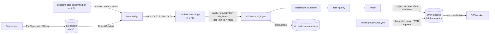

# 10 – Data platform and model governance (Step 13)

How data gets from the landing bucket into a trained model, and how a model reaches the
optimizer. DevOps owns the AWS side, the Airflow DAG wrapper and the pipelines. The data team
owns the Databricks jobs (transforms, Great Expectations checks, training) and the DAG logic
they add later.

Everything here is off until `enable_data_platform = true` in the environment's tfvars.

## 1. Flow



| Piece | Where | Name (dev) |
|---|---|---|
| MWAA environment (Airflow 2.10.3, private web server) | `infra/modules/mwaa` | `mmm-dev-airflow` |
| DAG bucket (`dags/`, `requirements.txt`, `release.json`) | buckets `mwaa` | `wbd-mmm-dev-mwaa-use1` |
| Data-quality suites and results | buckets `data-quality` | `wbd-mmm-dev-data-quality-use1` |
| Trigger Lambda, rules, DLQ, alarms | `infra/modules/data-trigger` | `mmm-dev-data-trigger`, `mmm-dev-data-trigger-dlq` |
| Unity Catalog IAM role, PrivateLink | `infra/modules/databricks-access` | `mmm-dev-databricks-uc` |
| Per-business-unit KMS keys | `kms` module | `alias/mmm-dev-s3-streaming`, … |
| DAG, manifest schema, suites, thresholds | `data/` | – |
| Pipelines | `.github/workflows/data.yml`, `model-governance.yml` | – |

## 2. Trigger: exactly one run per file or request

* **S3**: an `Object Created` event under `<business_unit>/` in the landing bucket. Other
  prefixes and folder markers are ignored.
* **On demand**: an EventBridge event with source `mmm.ondemand` and detail-type
  `Data refresh requested`. Either run `scripts/trigger-ondemand.sh <env> <bu|all> "<reason>"`
  or have the API send the event. The detail is `{business_unit, request_id, requested_by, reason}`.
* **Idempotency**: the Lambda names the Airflow run deterministically:
  `s3__sha256(bucket|key|etag)[:32]` or `ondemand__sha256(request_id)[:32]`. If EventBridge
  delivers the event again, or the Lambda retries, Airflow answers 409 and the Lambda logs
  `"result": "duplicate"`. Uploading the same object again with new content changes the ETag,
  so it starts a new run.
* **Failures**: EventBridge retries for an hour (10 attempts), and the Lambda's own async retries
  apply too. Events that still fail land in `mmm-<env>-data-trigger-dlq`. Two alarms go to the
  alert topic: `mmm-<env>-data-trigger-errors` and `mmm-<env>-data-trigger-dlq-not-empty`.
  After the cause is fixed, check the DLQ message and send the event again: re-upload the
  object, or re-run `trigger-ondemand.sh`.
* **Logs**: `/aws/lambda/mmm-<env>-data-trigger` (JSON lines with `result`, `dag_run_id`).
  They are shipped to Splunk like the other log groups.

## 3. MWAA

* **Access**: the web server is `PRIVATE_ONLY`. It is reachable only from inside the VPC or from
  the WBD network over the Transit Gateway. To open the UI, an engineer whose SSO permission set
  allows `airflow:CreateWebLoginToken` on `arn:aws:airflow:<region>:<acct>:role/mmm-<env>-airflow/<Role>`
  opens the MWAA console and clicks *Open Airflow UI*. WBD adds that permission to its permission
  sets (docs/02): `User` for the data team, `Admin` for DevOps.
* **Settings**: the DAG reads `mmm.*` Airflow configuration options set by Terraform
  (`environment`, `name_prefix`, `landing_bucket`, `results_bucket`, `quality_bucket`,
  `business_units`, `model_catalog`). No bucket names are hardcoded in the DAG.
* **Connections**: from Secrets Manager under `mmm/<env>/airflow/connections/<conn_id>`. See §5.
* **Logs**: the DAG-processing, scheduler, task, webserver and worker logs go to CloudWatch
  (KMS key `mwaa`). Task and scheduler logs go to Splunk too. Alarm:
  `mmm-<env>-airflow-scheduler-heartbeat`.
* **Size** (`data.tf` `mwaa_sizing`): dev and staging `mw1.small` (1–2 and 1–4 workers), prod
  `mw1.medium` (2–10 workers), 2 schedulers. Creating or updating the environment takes 20–30 min.
* **Execution role** `mmm-<env>-mwaa-exec`: it can read the DAG bucket, write logs, use its
  SQS queues, read `mmm/<env>/airflow/*` secrets, and read/write the landing, results and
  data-quality buckets (with their keys). It has no other access.

## 4. Databricks setup (WBD Databricks admins, once per environment)

The steps are in order. Steps 1–3 need the AWS side applied first, with
`enable_data_platform = true`.

1. **Unity Catalog storage credential, phase 1.** `terraform output data_platform` shows
   `uc_role_arn`. In Databricks, create a storage credential with that role ARN. Databricks shows
   an **External ID**; it must equal `databricks_account_id` in the tfvars. If it differs, set the
   variable to the value shown and apply.
2. **Phase 2 (self-assume).** Databricks requires the role to trust itself. Set
   `databricks_self_assume_enabled = true` in the tfvars, open a PR and apply. Then click
   *Validate configuration* on the storage credential.
3. **External locations** on the same credential: `s3://wbd-mmm-<env>-landing-use1/`,
   `s3://wbd-mmm-<env>-results-use1/` and `s3://wbd-mmm-<env>-data-quality-use1/`. The role can
   decrypt with the S3 key and the business-unit keys.
4. **Catalog** `mmm_<env-short>` (or `databricks_catalog`) with schema `models`. The models are
   `mmm_<env-short>.models.mmm_<business_unit>`.
5. **Service principals** (no secrets in GitHub):

   | Service principal | Used by | Unity Catalog grants | GitHub OIDC federation policy subject |
   |---|---|---|---|
   | `mmm-<env>-airflow` | MWAA (`databricks_default`) | run the three jobs | – (OAuth secret, §5) |
   | `mmm-<env>-model-eval` | `model-governance.yml` evaluate job | `USE CATALOG`, `USE SCHEMA`, `EXECUTE` and `APPLY TAG` on the models; read on the experiments | `repo:<org>/<repo>:ref:refs/heads/main` |
   | `mmm-<env>-model-promote` | promote / rollback job | as eval plus `MANAGE` on the models (to set aliases) | `repo:<org>/<repo>:environment:<env>-model-promotion` |

   Federation policy (account console → service principal → *Credentials & secrets* →
   *Federation policies*): issuer `https://token.actions.githubusercontent.com`, the subject
   above, and the audience Databricks proposes for the workspace. Put the application IDs into
   `databricks_eval_client_id` / `databricks_promote_client_id` and apply. Then run
   `scripts/setup-github.ps1` so the repository variables are set. The promote principal trusts
   only the approval environment, so it cannot be used without a WBD approval.
6. **Jobs** owned by the data team, named `mmm-<env>-transform`, `mmm-<env>-data-quality` and
   `mmm-<env>-retrain`, are deployed with their own Databricks Asset Bundle. Each receives the job
   parameters `environment`, `business_unit`, `source_bucket`, `source_key` and `airflow_run_id`.
   `data_quality` also gets `suites_uri` / `results_uri`, and `retrain` gets `model_catalog` and
   `register_alias=candidate`. `retrain` must log the metrics named in
   `data/model-thresholds.yaml` on the MLflow run of the version it registers.
7. **PrivateLink (optional)**: set `enable_databricks_privatelink = true` and
   `databricks_privatelink_service_name` (from Databricks for the region). Terraform creates the
   interface endpoint and a private hosted zone for the workspace host, so MWAA, the Lambda and
   the ECS workers reach Databricks privately. WBD then registers the endpoint in the Databricks
   account (*Network connectivity* → *VPC endpoint*) and attaches it to the workspace's private
   access settings.

## 5. Secrets and settings

| What | Where | Filled by |
|---|---|---|
| Airflow → Databricks connection | Secrets Manager `mmm/<env>/airflow/connections/databricks_default` | WBD Databricks admin, once |
| `mmm_databricks_enabled` | Airflow Variable (UI → Admin → Variables) | Data team, after §4 is done |
| GitHub → Databricks | none: OIDC federation, client IDs are repository variables | Terraform outputs + `setup-github.ps1` |
| ECS workers → MLflow | `DATABRICKS_HOST` + SP token from `mmm/<env>/databricks/sp` (Step 5; injected once `databricks_token_available = true`); `MLFLOW_TRACKING_URI=databricks`, `MLFLOW_REGISTRY_URI=databricks-uc`, `MODEL_CATALOG`, `MODEL_ALIAS=production` | Terraform |

Connection value (JSON; the client secret of `mmm-<env>-airflow`):

```powershell
$v = @{ conn_type = 'databricks'; host = 'https://dbc-00000000-0000.cloud.databricks.com'
        login = '<sp-application-id>'; password = '<sp-oauth-secret>'
        extra = @{ service_principal_oauth = $true } } | ConvertTo-Json -Compress
aws secretsmanager put-secret-value --secret-id mmm/dev/airflow/connections/databricks_default --secret-string $v --profile mmm-dev-devops
```

Until `mmm_databricks_enabled` is `true`, the `databricks_enabled` task skips the three
Databricks tasks. That lets the trigger → MWAA → manifest path be tested without Databricks.

## 6. Releasing DAGs (`data.yml`)

| Event | Result |
|---|---|
| PR touching `data/**` | ruff, DAG import test (Airflow 2.10.3 + MWAA constraints), manifest schema tests, thresholds and JSON checks |
| Merge to `main` | validate, then publish to dev |
| Tag `data-vX.Y.Z-rcN` | publish to staging (environment `staging`: EY delivery lead approves) |
| Tag `data-vX.Y.Z` | publish to prod (environment `prod`: WBD approver); refused unless an `-rcN` tag is on the same commit |

Publishing runs these steps in order:

1. **`requirements.txt`**: uploaded only if its SHA-256 changed, then `update-environment` with
   the new object version, and the job waits for `AVAILABLE`. If the update fails, MWAA keeps
   the previous requirements and the job fails.
2. **DAGs**: `data/dags` is synced to `s3://<mwaa bucket>/dags/` with `--delete`.
3. **Quality suites**: `data/quality` is synced to `s3://<quality bucket>/suites/`.
4. **Release record**: `release.json` (version, commit, actor, run) is written to the bucket
   and to the job summary.

To roll back, re-run `data.yml` for the previous tag (*Run workflow*, choose the environment),
or push a revert to `main`. The data team never uploads to MWAA by hand. A pipeline for the
Databricks bundle is added when the data team provides one.

## 7. Model governance (`model-governance.yml`)

```mermaid
sequenceDiagram
  participant R as retrain job
  participant UC as Unity Catalog registry
  participant G as model-governance (hourly)
  participant A as WBD approver
  R->>UC: register version N, alias candidate, metrics on run
  G->>UC: candidate without governance tag?
  G->>G: compare metrics with data/model-thresholds.yaml
  alt any metric fails or is missing
    G->>UC: tag governance_status=failed + checks, remove candidate alias
    Note over G: warning in run, report artifact; never promoted
  else all pass
    G->>UC: tag governance_status=passed
    G->>A: start promote run (environment <env>-model-promotion)
    A-->>G: approve (cannot approve own run)
    G->>UC: alias production -> N, tag previous_production_version
  end
```

* **Thresholds**: `data/model-thresholds.yaml`, per business unit and metric, `{min}` and/or
  `{max}`. A missing or non-finite metric fails. The file is a placeholder until WBD and EY sign
  it off. To test locally:
  `python scripts/model_governance.py evaluate-file --business-unit streaming --metrics m.json`
  (exit 0 = pass, 2 = fail).
* **Evidence**: tags on the model version (`governance_status`, `governance_checks`,
  `governance_evaluated_at`, `governance_run`, `promoted_by`, `promoted_at`, `promotion_run`) and
  the `model-evaluation-<env>-<run>` artifact, kept 90 days.
* **Manual runs** (*Actions → model-governance → Run workflow*):
  * `evaluate`: one business unit or `all`; set a `version` to re-evaluate it.
  * `promote`: business unit and version. Only `passed` versions can be promoted.
  * `rollback`: business unit. By default `production` moves back to `previous_production_version`;
    set a `version` to choose one. It needs the same approval.
* **Workers** load `models:/<catalog>.models.mmm_<bu>@production`. A new model is picked up at
  the next model load or worker deploy; no image change is needed.
* **Environments**: an environment is evaluated only if its `DATABRICKS_HOST_<ENV>` repository
  variable exists, i.e. its data platform is enabled and `setup-github.ps1` ran.

GitHub setup (once per environment, by a repository admin):

```powershell
.\scripts\setup-github.ps1 -Repo wbd-org/wbd-mmm-platform -Environment prod -ReviewerTeams wbd-release-approvers `
  -ModelApproverTeams wbd-model-approvers
```

This creates `prod-model-promotion` (required reviewers, prevent self-review, `main` only) and
adds the `data-v*` tag policy to `staging` and `prod`.

## 8. Encryption and access per business unit

* The landing bucket policy denies `PutObject` under `<bu>/` unless the object is encrypted with
  `alias/mmm-<env>-s3-<bu>`. Feeds must send
  `--sse aws:kms --sse-kms-key-id <that key ARN>` (`business_unit_keys` in `terraform output data_platform`).
* Other buckets keep the shared S3 key. Unity Catalog, MWAA and the Lambda are granted only the
  keys they need.

## 9. Troubleshooting

| Symptom | Check |
|---|---|
| File landed, no DAG run | Lambda log: `ignored` means wrong prefix. Look for errors or messages in the DLQ. Check EventBridge is enabled on the landing bucket (`aws s3api get-bucket-notification-configuration`). |
| Lambda `AccessDenied` on InvokeRestApi | the role allows only `mmm-<env>-airflow/User`; check `airflow_role_arn` |
| Lambda times out | its security group allows 443 out; check the NAT route / PrivateLink for the MWAA API |
| `PutObject` AccessDenied on landing | wrong or missing business-unit KMS key in the upload |
| Databricks tasks skipped | Airflow Variable `mmm_databricks_enabled` is not `true` |
| Databricks task `Invalid credentials` | the `databricks_default` secret JSON, or the SP OAuth secret has expired |
| `requirements.txt` update `UPDATE_FAILED` | MWAA console → *Last update* error; the package conflicts with the constraints file |
| model-governance `401` | federation policy subject or audience mismatch; compare the subject with §4 step 5 |
| Promote refused | the version is not tagged `governance_status=passed`; evaluate it first |
