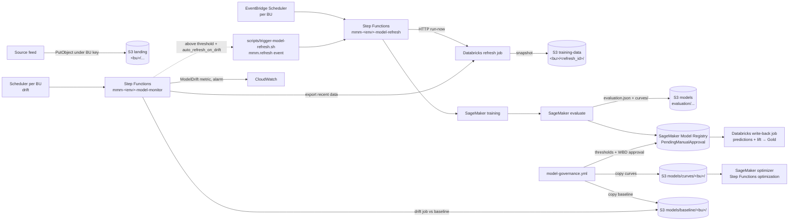

# 10 – Data platform and model governance (Step 13)

How a business unit moves from landing-zone data to a trained model in the SageMaker Model Registry,
how predictions and lift are written back to Databricks, how an approved model’s response curves
reach the optimizer, and how drift is watched afterwards. DevOps owns the AWS plumbing,
Step Functions, schedules, and governance pipelines. The data team owns the Databricks Asset Bundle
(`data/databricks/`) and the refresh job logic.

Everything here is off until `enable_data_platform = true` in the environment’s tfvars.

## 1. Flow



| Piece | Where | Name (dev) |
|---|---|---|
| Unity Catalog IAM role, optional PrivateLink | `infra/modules/databricks-access` | `mmm-dev-databricks-uc` |
| EventBridge connection (Databricks OAuth) | `infra/environments/<env>/data.tf` | `mmm-dev-databricks` |
| Model-refresh state machine | `infra/modules/step-functions` | `mmm-dev-model-refresh` |
| Schedules (one per BU) | `data.tf` | `mmm-dev-refresh-<bu>` in group `mmm-dev-model-refresh` |
| On-demand rule | `data.tf` | `mmm-dev-model-refresh-on-demand` |
| Model-monitor (drift) state machine | `infra/modules/step-functions` | `mmm-dev-model-monitor` |
| Drift schedules (one per BU) and alarms | `data.tf` | `mmm-dev-drift-<bu>` in group `mmm-dev-model-monitor`; alarm `mmm-dev-model-drift-<bu>` |
| SageMaker training role and model package groups | `infra/modules/sagemaker` | `mmm-dev-training`, groups `mmm-dev-<bu>` |
| Thresholds and bundle hook | `data/` | `model-thresholds.yaml`, `databricks/` (data team) |
| Pipelines | `.github/workflows/databricks.yml`, `model-governance.yml` | – |

## 2. Triggers

* **Schedule**: EventBridge Scheduler runs `mmm-<env_short>-refresh-<business_unit>` in group
  `mmm-<env_short>-model-refresh` when `enable_model_refresh_schedule = true`. Expression and time
  zone come from `model_refresh_schedule` and `model_refresh_timezone` (defaults in tfvars:
  `cron(0 6 ? * MON *)`, `America/New_York`).
* **On demand**: EventBridge event with source `mmm.refresh`, detail-type `Model Refresh Requested`,
  and detail `{business_unit, requested_by, reason}`. Run
  `scripts/trigger-model-refresh.sh <env> <bu|all> [reason]` or send the same event from an approved
  caller (for example the API). For `all`, the script discovers business units from the schedule
  group. An unknown `business_unit` matches no rule and starts nothing.
* **Idempotency**: each execution gets a new `refresh_id` (UUID in the `Init` state). Re-running the
  trigger starts a new refresh; there is no duplicate suppression on the event itself.
* **Logs**: state machine log group `/aws/states/mmm-<env>-model-refresh`, SageMaker training/processing
  logs, and Splunk groups `sfn-model-refresh`
  and `sagemaker-train` when shipping is enabled. Alarm: `mmm-<env>-model-refresh-failed`.

## 3. Model-refresh state machine

State machine `mmm-<env>-model-refresh` (6 h timeout). Definition: `infra/environments/<env>/data.tf`.

| Step | What it does |
|---|---|
| **Init** | Sets `refresh_id` to a new UUID; keeps `business_unit` from the input. |
| **GetTrainingImage** | Reads SSM `/mmm/<env_short>/images/sagemaker-training` (image digest pointer). |
| **StartDatabricksJob** | HTTP `POST /api/2.2/jobs/run-now` via EventBridge connection `mmm-<env>-databricks`; job id `databricks_refresh_job_id`; parameters `business_unit` and `snapshot_uri` `s3://<training-data>/<bu>/<refresh_id>/`. |
| **WaitForDatabricks / GetDatabricksRun** | Polls `runs/get` every 60 s until success or terminal failure. |
| **TrainModel** | SageMaker training job `mmm-<env>-train-<refresh_id>` on the snapshot; artifacts under `s3://<models>/artifacts/<bu>/`. |
| **EvaluateModel** | Processing job `mmm-<env>-eval-<refresh_id>` (same image, argument `evaluate`); writes `s3://<models>/evaluation/<bu>/<refresh_id>/evaluation.json` and `curves/`. |
| **RegisterModel** | `CreateModelPackage` in group `mmm-<env_short>-<bu>` with status `PendingManualApproval` and `ModelMetrics` pointing at `evaluation.json`. |
| **StartDatabricksWriteback / WaitForWriteback / GetWritebackRun** | `run-now` of job `databricks_writeback_job_id` with `business_unit`, `refresh_id`, `results_uri` (the evaluation prefix, incl. `predictions/` and `lift/`) and `model_package_arn`; polled every 60 s. The data team's job writes predictions and lift to the Gold tables, tagged with the package ARN (the approval status stays in the registry). |
| **WritebackDone** | `SUCCESS` → **RefreshComplete**; failed or cancelled → **WritebackFailed** (the execution fails, `model-refresh-failed` alarm; the package stays registered—[runbooks/write-back-failed.md](runbooks/write-back-failed.md)). |

Training uses `training_instance_type` and `training_max_runtime_seconds`. Evaluation uses the
optimizer instance sizing from the environment tfvars (`optimizer_instance_type`,
`optimizer_max_runtime_seconds`).

### 3b. Model-monitor (drift) state machine

State machine `mmm-<env>-model-monitor`, one execution per business unit, started by schedule
`mmm-<env_short>-drift-<bu>` (`model_monitor_schedule`, default `cron(0 7 * * ? *)`, only with
`enable_model_monitor_schedule = true`) or by hand with `{"business_unit": "<bu>"}`.

| Step | What it does |
|---|---|
| **ApplyDefaults / Init** | Fills `drift_threshold` (from `data/model-thresholds.yaml` `business_units.<bu>.drift.threshold` in the schedule input, else `model_drift_threshold`) and `auto_refresh` (`auto_refresh_on_drift`); sets `monitor_id` and `monitor_date`. |
| **StartDatabricksExport** (+ wait / poll) | The refresh job (`databricks_refresh_job_id`) with `purpose = monitor` exports recent features to `s3://<lakehouse>/monitoring/<bu>/<date>/` (kept 90 days). |
| **CheckDrift** | Processing job (training image, argument `drift`) compares that data with `s3://<models>/baseline/<bu>/` and `curves/<bu>/` of the approved model; writes `drift.json` under `s3://<models>/monitoring/<bu>/<date>/`. |
| **ReadDrift / PublishDrift** | Reads `drift.json` (`{"score": 0–1, "checks": {...}}`) and puts metric `MMM/Models` `ModelDrift` (dimensions `BusinessUnit`, `Check=overall`). |
| **DriftDecision** | Score above threshold and `auto_refresh` → **RequestRefresh** (`mmm.refresh` event, same as the on-demand trigger); above threshold only → **DriftDetected** (alarm `mmm-<env>-model-drift-<bu>` fires on the metric); otherwise **NoDrift**. |

The drift check needs a baseline, which exists only after the first approval (§7). Keep
`enable_model_monitor_schedule = false` until every business unit has an approved model.

## 4. Databricks setup (WBD Databricks admins, once per environment)

Apply AWS with `enable_data_platform = true` first. Host and job id live in tfvars (`databricks_host`,
`databricks_refresh_job_id`).

1. **Unity Catalog storage credential, phase 1.** `terraform output data_platform` shows `uc_role_arn`
   and `uc_external_id` (equals `databricks_account_id`). In Databricks, create a storage credential
   with that role ARN. The **External ID** must match `databricks_account_id`; if Databricks shows a
   different value, update the tfvar and apply.
2. **Phase 2 (self-assume).** Set `databricks_self_assume_enabled = true`, open a PR and apply. Then
   *Validate configuration* on the storage credential.
3. **External locations** on that credential: `s3://wbd-mmm-<env>-landing-<region_code>/`,
   `s3://wbd-mmm-<env>-lakehouse-<region_code>/`, and
   `s3://wbd-mmm-<env>-training-data-<region_code>/`. The role can decrypt with the shared S3 key and
   per-business-unit keys (`business_unit_keys` in the `data_platform` output).
4. **Refresh job** owned by the data team in `data/databricks/` (Asset Bundle). It must accept
   `business_unit` and `snapshot_uri` and write the training snapshot to that prefix. With
   `purpose = monitor` it writes only the latest features to `snapshot_uri`, which then points at
   `s3://<lakehouse>/monitoring/<bu>/<date>/` (drift check). After
   deploy, set `databricks_refresh_job_id` in tfvars to the job id.
   **Write-back job** (data team): accepts `business_unit`, `refresh_id`, `results_uri`,
   `model_package_arn`, reads `predictions/` and `lift/` under `results_uri` and writes the Gold
   tables; set `databricks_writeback_job_id`.
5. **Service principal for the state machine.** Create a workspace service principal; put its
   application (client) id in `databricks_sp_client_id`. Its OAuth client secret is **not** in Secrets
   Manager: DevOps sets it on the EventBridge connection (§5).
6. **Service principal for bundle deploy.** Federation policy subject
   `repo:<org>/<repo>:environment:<env>`, audience as Databricks proposes. Pass the application id to
   `scripts/setup-github.ps1 -DatabricksClientId …` so the GitHub Environment gets `DATABRICKS_CLIENT_ID`.
   `DATABRICKS_HOST` comes from Terraform (`github_environment_variables` output).
7. **PrivateLink (optional):** `enable_databricks_privatelink = true` and
   `databricks_privatelink_service_name`. Terraform creates the interface endpoint and private DNS for
   the workspace host so the state machine HTTP tasks (and other VPC clients) reach Databricks
   privately. WBD registers the endpoint in the Databricks account and attaches it to the workspace.

## 5. Secrets and settings

| What | Where | Filled by |
|---|---|---|
| Databricks OAuth for the state machine | EventBridge connection `mmm-<env>-databricks` (secret managed by EventBridge) | DevOps out of band after apply ([docs/05](05-secrets-and-config.md)) |
| Provider keys (not used here) | – | – |
| GitHub → Databricks bundle deploy | Environment vars `DATABRICKS_HOST`, `DATABRICKS_CLIENT_ID` | Terraform + `setup-github.ps1` |
| GitHub → AWS governance | Repository vars `MODEL_EVAL_ROLE_ARN_<ENV>`, `MODEL_APPROVE_ROLE_ARN_<ENV>`, `MODELS_BUCKET_<ENV>` | Terraform `github_repository_variables` output |

Set the connection secret once (placeholder `set-out-of-band` is ignored on later applies):

```powershell
$env:AWS_PROFILE = "mmm-dev-devops"
aws events update-connection --name mmm-dev-databricks --authorization-type OAUTH_CLIENT_CREDENTIALS `
  --auth-parameters "OAuthParameters={ClientParameters={ClientID=<databricks_sp_client_id>,ClientSecret=<oauth-secret>},AuthorizationEndpoint=<databricks_host>/oidc/v1/token,HttpMethod=POST,OAuthHttpParameters={BodyParameters=[{Key=grant_type,Value=client_credentials},{Key=scope,Value=all-apis}]}}"
```

SSM `/mmm/<env>/databricks/host` mirrors `databricks_host` for operators and the bundle pipeline.

## 6. Releasing Databricks code (`databricks.yml`)

| Event | Result |
|---|---|
| Push to `main` touching `data/databricks/**` | Validate and deploy bundle target **dev** (skipped if `data/databricks/databricks.yml` is absent) |
| **workflow_dispatch** | Validate and deploy the chosen target (staging / prod use GitHub Environment approval) |

Auth is Databricks workload identity federation with GitHub OIDC (no Databricks token in GitHub).
The data team never deploys jobs by hand in production; DevOps merges bundle changes through this
workflow. Job parameters and the training/evaluation contract are in [data/README.md](../data/README.md).

## 7. Model governance (`model-governance.yml`)

Details also in [scripts/README.md](../scripts/README.md) (§7 here).

```mermaid
sequenceDiagram
  participant SF as model-refresh SFN
  participant SM as SageMaker Model Registry
  participant G as model-governance (hourly)
  participant A as WBD approver
  SF->>SM: register version N, PendingManualApproval + ModelMetrics
  G->>SM: PendingManualApproval without governance tag?
  G->>G: compare evaluation.json with data/model-thresholds.yaml
  alt any metric fails or is missing
    G->>SM: tag governance_status=failed, status Rejected
    Note over G: warning in run; never approvable
  else all pass
    G->>SM: tag governance_status=passed
    G->>A: dispatch promote (environment <env>-model-promotion)
    A-->>G: approve (cannot approve own run)
    G->>SM: status Approved; copy curves to s3://<models>/curves/<bu>/ and baseline/ to baseline/<bu>/
    G->>G: write approval.json next to evaluation.json
  end
```

* **Thresholds**: `data/model-thresholds.yaml`, per business unit and metric, `{min}` and/or `{max}`.
  Metrics must appear in `evaluation.json` (flat object). A missing or non-finite value fails. The
  file is a placeholder until WBD and EY sign it off. Offline checks:

  ```powershell
  pip install -r scripts/requirements-model-governance.txt
  python scripts/model_governance.py check-thresholds
  python scripts/model_governance.py evaluate-file --business-unit streaming --metrics evaluation.json
  ```

  (`evaluate-file` exit 0 = pass, 2 = fail.)

* **Roles**: hourly/dispatch **evaluate** uses `mmm-<env>-gha-model-eval` (GitHub OIDC, main branch).
  It may tag and **reject** failing packages only. **promote** and **rollback** run in GitHub
  Environment `<env>-model-promotion` (WBD model approvers, prevent self-review) with
  `mmm-<env>-gha-model-approve`: sets **Approved**, copies `evaluation/.../curves/` to
  `s3://<models bucket>/curves/<bu>/` plus `_model_package.json` (what the optimizer reads), and
  `evaluation/.../baseline/` to `s3://<models bucket>/baseline/<bu>/` (the drift reference; a
  version without `baseline/` gets a warning and an empty baseline, so the drift check fails until
  a version with a baseline is approved). Rollback re-publishes both.

* **Thresholds file** also holds `baseline_prefix` and an optional `drift: {threshold: x}` per
  business unit (0 < x < 1); `check-thresholds` validates both. A change to the file is applied by
  `terraform.yml` (the drift schedules carry the threshold).

* **Evidence**: SageMaker tags (`governance_status`, `governance_checks`, `governance_evaluated_at`,
  `previous_approved_version`, `approved_by`, …), `approval.json` next to `evaluation.json`
  (environment, BU, package ARN, version, previous version, approver, time, run URL, checks, file
  counts) and artifact `model-evaluation-<env>-<run>` (90 days).

* **Manual runs** (*Actions → model-governance → Run workflow*):
  * `evaluate`: one business unit or `all`; optional `version` to re-evaluate.
  * `promote`: business unit and version (must be tagged `passed`).
  * `rollback`: re-publish curves from `previous_approved_version` or `--version`; reject the current
    approved package (same approval gate).

* **Environments**: evaluate runs only where `MODEL_EVAL_ROLE_ARN_<ENV>` exists (data platform enabled
  and repository variables set from Terraform).

GitHub setup (once per environment, repository admin):

```powershell
.\scripts\setup-github.ps1 -Repo Yashwanth-wbd/wbd-aws-devops -Environment prod -ReviewerTeams wbd-release-approvers `
  -ModelApproverTeams wbd-model-approvers -DatabricksClientId <bundle-deploy-sp-app-id>
```

This creates `prod-model-promotion` (required reviewers, prevent self-review) and configures staging/prod
tag policies for app releases (`v*` tags only).

## 8. Encryption and access per business unit

* The landing bucket policy denies `PutObject` under `<bu>/` unless the object is encrypted with
  `alias/mmm-<env>-s3-<bu>`. Feeds must send
  `--sse aws:kms --sse-kms-key-id <that key ARN>` (`business_unit_keys` in `terraform output data_platform`).
* Lakehouse, training-data, and models buckets use the shared S3 KMS key unless a bucket policy says
  otherwise. Unity Catalog and SageMaker roles receive only the keys they need.

## 9. Enabling, verification, troubleshooting

### Enabling (per environment: dev → staging → prod)

1. In `infra/environments/<env>/terraform.tfvars`: set `enable_data_platform = true` and WBD values for
   `databricks_account_id`, `databricks_host`, `databricks_sp_client_id`, `databricks_refresh_job_id`,
   `databricks_writeback_job_id`, `training_instance_type`, `training_max_runtime_seconds`,
   `model_refresh_schedule`, `model_refresh_timezone`, `model_monitor_schedule`,
   `model_drift_threshold`, `auto_refresh_on_drift`, and optionally `enable_model_refresh_schedule`,
   `enable_model_monitor_schedule` (after the first approval),
   `databricks_self_assume_enabled`, `enable_databricks_privatelink`,
   `databricks_privatelink_service_name`. PR → plan → apply (`terraform.yml`).
2. Complete Databricks §4 (UC phase 2, refresh job deployed via `databricks.yml`, connection secret §5).
3. Run `scripts/setup-github.ps1` for the environment (model promotion reviewers and
   `DATABRICKS_CLIENT_ID` when the bundle exists).
4. Confirm `terraform output -json data_platform` and repository variables
   `MODEL_*_<ENV>` / `MODELS_BUCKET_<ENV>`.

### Verification commands

```powershell
$env:AWS_PROFILE = "mmm-dev-devops"
$dp = terraform output -json data_platform | ConvertFrom-Json
# Start one refresh (after connection secret and job id are valid)
scripts/trigger-model-refresh.sh dev streaming "validation"
aws stepfunctions list-executions --state-machine-arn $dp.refresh_state_machine --max-results 5 `
  --query "executions[].[name,status,startDate]" --output table
# Or start directly:
aws stepfunctions start-execution --state-machine-arn $dp.refresh_state_machine `
  --input '{"business_unit":"streaming"}'
# Registry packages for a BU
aws sagemaker list-model-packages --model-package-group-name "mmm-dev-streaming" `
  --model-approval-status PendingManualApproval --sort-by CreationTime --sort-order Descending
# Drift check for one BU (after an approval published models/baseline/streaming/)
aws stepfunctions start-execution --state-machine-arn $dp.monitor_state_machine `
  --input '{"business_unit":"streaming"}'
aws cloudwatch get-metric-statistics --namespace MMM/Models --metric-name ModelDrift `
  --dimensions Name=BusinessUnit,Value=streaming Name=Check,Value=overall `
  --start-time (Get-Date).ToUniversalTime().AddDays(-7).ToString("s") --end-time (Get-Date).ToUniversalTime().ToString("s") `
  --period 86400 --statistics Maximum
```

Governance: `gh workflow run model-governance.yml -f environment=dev -f action=evaluate -f business_unit=streaming`.

### Troubleshooting

| Symptom | Check |
|---|---|
| Refresh never starts | Scheduler `state` DISABLED; on-demand detail `business_unit` must match a configured BU; rule `mmm-<env>-model-refresh-on-demand` enabled |
| `StartDatabricksJob` auth errors | EventBridge connection secret and `databricks_sp_client_id`; connection name in `data_platform.databricks_connection` |
| Databricks poll fails or times out | Job id; run in Databricks UI; PrivateLink / NAT if workspace is private |
| Training or evaluate fails | SageMaker log groups under `/aws/sagemaker/`; image pointer SSM; snapshot prefix exists in training-data |
| No `evaluation.json` | Processing job output path; training image `evaluate` entrypoint |
| Governance skipped | `MODEL_EVAL_ROLE_ARN_<ENV>` unset; package already tagged `governance_status` |
| Promote refused | Tag `governance_status=passed`; version still `PendingManualApproval` |
| Optimizer uses old curves | Promote copies to `models/curves/<bu>/`; check `_model_package.json` |
| Refresh fails at `WritebackFailed` | Databricks write-back run in the UI; `databricks_writeback_job_id`; [runbooks/write-back-failed.md](runbooks/write-back-failed.md) |
| Monitor fails at `CheckDrift` | `models/baseline/<bu>/` empty (no approved version with a baseline yet); training image `drift` entrypoint; [runbooks/model-drift.md](runbooks/model-drift.md) |
| `model-drift-<bu>` in ALARM | [runbooks/model-drift.md](runbooks/model-drift.md) |
