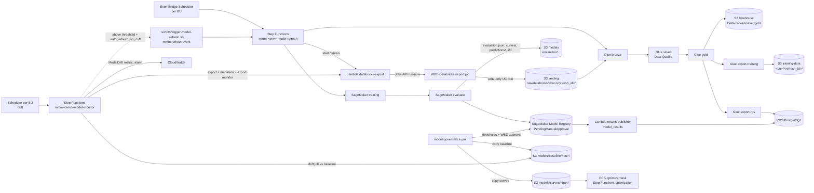

# 10 – Data platform and model governance (Step 13, v4)

How a business unit moves from the WBD Databricks catalog to a trained model in the SageMaker Model
Registry, how predictions, lift and evaluation results reach RDS, how an approved model's response
curves reach the optimizer, and how drift is watched afterwards.

In v4 **Databricks is only the source catalog**: a WBD-owned export job writes raw Parquet into
this account, and everything after that runs in AWS (Glue lakehouse, SageMaker, RDS). DevOps owns
the AWS plumbing, Step Functions, schedules and governance pipelines. The data engineers own the
Glue job scripts (`data/glue/jobs/`) and the Data Quality rules (`data/glue/dq/`); WBD owns the
Databricks export job.

Everything here is off until `enable_data_platform = true` in the environment's tfvars.

## 1. Flow



| Piece | Where | Name (dev) |
|---|---|---|
| Unity Catalog IAM role (write-only `raw/databricks/`), optional PrivateLink | `infra/modules/databricks-access` | `mmm-dev-databricks-uc` |
| Databricks export Lambda | `infra/modules/databricks-export` | `mmm-dev-databricks-export` |
| Glue catalog, jobs, Data Quality ruleset, role | `infra/modules/glue` | databases `mmm_dev_bronze/_silver/_gold`, jobs `mmm-dev-glue-<job>`, ruleset `mmm-dev-silver`, role `mmm-dev-glue` |
| Buckets | `infra/environments/<env>/main.tf` | `landing`, `lakehouse`, `training-data`, `glue-assets`, `models` |
| Model-refresh state machine | `infra/modules/step-functions` (definition in `data.tf`) | `mmm-dev-model-refresh` |
| Schedules (one per BU) | `data.tf` | `mmm-dev-refresh-<bu>` in group `mmm-dev-model-refresh` |
| On-demand rule | `data.tf` | `mmm-dev-model-refresh-on-demand` |
| Model-monitor (drift) state machine | `infra/modules/step-functions` | `mmm-dev-model-monitor` |
| Drift schedules (one per BU) and alarms | `data.tf` | `mmm-dev-drift-<bu>` in group `mmm-dev-model-monitor`; alarm `mmm-dev-model-drift-<bu>` |
| SageMaker training role and model package groups | `infra/modules/sagemaker` | `mmm-dev-training`, groups `mmm-dev-<bu>` |
| Glue scripts, DQ rules, thresholds | `data/` | `glue/jobs/*.py` and `glue/dq/silver.dqdl` (data engineers add them; until then a seed script and `RowCount > 0`), `model-thresholds.yaml` |
| Pipelines | `.github/workflows/glue.yml`, `model-governance.yml` | – |

## 2. Triggers

* **Schedule**: EventBridge Scheduler runs `mmm-<env_short>-refresh-<business_unit>` in group
  `mmm-<env_short>-model-refresh` when `enable_model_refresh_schedule = true`. Expression and time
  zone come from `model_refresh_schedule` and `model_refresh_timezone` (defaults in tfvars:
  `cron(0 6 ? * MON *)`, `America/New_York`).
* **On demand**: EventBridge event with source `mmm.refresh`, detail-type `Model Refresh Requested`,
  and detail `{business_unit, requested_by, reason}`. Run
  `scripts/trigger-model-refresh.sh <env> <bu|all> [reason]` or send the same event from an approved
  caller (for example the API). For `all`, the script discovers business units from the schedule
  group. An unknown `business_unit` matches no rule and starts nothing.
* **Idempotency**: each execution gets a new `refresh_id` (UUID in the `Init` state); it is also the
  idempotency token of the Databricks `run-now`, so a retried start does not export twice.
* **Logs**: state machine log group `/aws/states/mmm-<env>-model-refresh`, export Lambda
  `/aws/lambda/mmm-<env_short>-databricks-export`, Glue `/aws-glue/jobs/mmm-<env_short>`,
  SageMaker training / processing logs; Splunk groups `sfn-model-refresh`, `databricks-export`,
  `glue-jobs`, `sagemaker-train`, `sagemaker-jobs` when shipping is enabled. Alarms:
  `mmm-<env>-model-refresh-failed`, `databricks-export-errors`; events `glue-job-failed`,
  `glue-data-quality-failed`. Dashboard `mmm-<env_short>-data-pipeline`.

## 3. Model-refresh state machine

State machine `mmm-<env>-model-refresh` (8 h timeout). Definition: `infra/environments/<env>/data.tf`.

| Step | What it does |
|---|---|
| **Init** | Sets `refresh_id` to a new UUID; keeps `business_unit` from the input. |
| **GetTrainingImage** | Reads SSM `/mmm/<env_short>/images/sagemaker-training` (image digest pointer). |
| **StartExport** | Export Lambda `action = start`: OAuth token for the `databricks/export-sp` service principal, job id from SSM `databricks/export_job_ids[<bu>]`, `run-now` with `business_unit`, `output_uri` `s3://<landing>/raw/databricks/<bu>/<refresh_id>/`, `purpose = refresh`, `request_id`. |
| **WaitForExport / GetExportStatus / ExportDone** | Polls `runs/get` every 60 s. On success the Lambda writes `_manifest.json` next to the export; a failed run → **ExportFailed** ([runbooks/databricks-export-failed.md](runbooks/databricks-export-failed.md)). |
| **Bronze** | Glue `mmm-<env_short>-glue-bronze` (`--raw_uri` = the export folder): raw → Bronze Delta tables (job bookmarks on). |
| **Silver** | Glue `-silver`: cleanse and conform; evaluates the Data Quality ruleset `mmm-<env_short>-silver` and fails on a failed rule. |
| **Gold** | Glue `-gold`: per-BU modeling tables (adstock, saturation). |
| **GlueExports** | In parallel: `-export-training` writes the immutable Parquet snapshot `s3://<training-data>/<bu>/<refresh_id>/` (Object Lock); `-export-rds` writes the reference tables to RDS through RDS Proxy as `mmm_etl` (IAM token). Any Glue failure: [runbooks/glue-job-failed.md](runbooks/glue-job-failed.md). |
| **TrainModel** | SageMaker training job `mmm-<env_short>-train-<refresh_id>` on the snapshot; artifacts under `s3://<models>/artifacts/<bu>/`. |
| **EvaluateModel** | Processing job `mmm-<env_short>-eval-<refresh_id>` (same image, argument `evaluate`: baseline → channel lift → title adjustment); writes `s3://<models>/evaluation/<bu>/<refresh_id>/evaluation.json`, `curves/`, `baseline/`, `predictions/`, `lift/`. |
| **RegisterModel** | `CreateModelPackage` in group `mmm-<env_short>-<bu>` with status `PendingManualApproval`, `ModelMetrics` pointing at `evaluation.json` and the Databricks run id / refresh id as metadata. |
| **PublishModelResults** | Results publisher (alias `live`) with `{"event": "model_results", business_unit, refresh_id, model_package_arn, evaluation_uri}`: writes predictions, lift and evaluation results to RDS for that dataset, tagged with the package ARN (the approval status stays in the registry). |

Registration runs before publishing so the RDS rows carry the `model_package_arn`. Training uses
`training_instance_type` / `training_max_runtime_seconds`; evaluation and the drift check use
`evaluation_instance_type` / `evaluation_max_runtime_seconds`. Glue jobs use `glue_version`,
`glue_worker_type`, `glue_number_of_workers`, `glue_job_timeout_minutes`.

### 3b. Model-monitor (drift) state machine

State machine `mmm-<env>-model-monitor`, one execution per business unit, started by schedule
`mmm-<env_short>-drift-<bu>` (`model_monitor_schedule`, default `cron(0 7 * * ? *)`, only with
`enable_model_monitor_schedule = true`) or by hand with `{"business_unit": "<bu>"}`.

| Step | What it does |
|---|---|
| **ApplyDefaults / Init** | Fills `drift_threshold` (from `data/model-thresholds.yaml` `business_units.<bu>.drift.threshold` in the schedule input, else `model_drift_threshold`) and `auto_refresh` (`auto_refresh_on_drift`); sets `monitor_id` and `monitor_date`. |
| **MonitorStartExport** (+ wait / poll) | The same export with `purpose = monitor` into `raw/databricks/<bu>/monitor-<monitor_id>/`. |
| **MonitorBronze / MonitorSilver / MonitorGold** | The medallion with `--purpose monitor`, so the check sees fresh, quality-checked data. |
| **ExportMonitorFeatures** | Glue `-export-monitor` writes the latest features to `s3://<lakehouse>/monitoring/<bu>/<date>/` (kept 90 days). |
| **CheckDrift** | Processing job (training image, argument `drift`) compares those features with `s3://<models>/baseline/<bu>/` and `curves/<bu>/` of the approved model; writes `drift.json` under `s3://<models>/monitoring/<bu>/<date>/`. |
| **ReadDrift / PublishDrift** | Reads `drift.json` (`{"score": 0–1, "checks": {...}}`) and puts metric `MMM/Models` `ModelDrift` (dimensions `BusinessUnit`, `Check=overall`). |
| **DriftDecision** | Score above threshold and `auto_refresh` → **RequestRefresh** (`mmm.refresh` event, same as the on-demand trigger); above threshold only → **DriftDetected** (alarm `mmm-<env>-model-drift-<bu>` fires on the metric); otherwise **NoDrift**. |

The drift check needs a baseline, which exists only after the first approval (§7). Keep
`enable_model_monitor_schedule = false` until every business unit has an approved model.

## 4. Databricks setup (WBD Databricks admins, once per environment)

Apply AWS with `enable_data_platform = true` first.

1. **Unity Catalog storage credential, phase 1.** `terraform output data_platform` shows `uc_role_arn`
   and `uc_external_id` (equals `databricks_account_id`). In Databricks, create a storage credential
   with that role ARN. The **External ID** must match `databricks_account_id`; if Databricks shows a
   different value, update the tfvar and apply.
2. **Phase 2 (self-assume).** Set `databricks_self_assume_enabled = true`, open a PR and apply. Then
   *Validate configuration* on the storage credential.
3. **External location** on that credential: `s3://wbd-mmm-<env>-landing-<region_code>/raw/databricks/`
   only. The role can write there (and nowhere else) and encrypt with the per-business-unit keys
   (`business_unit_keys` in the `data_platform` output); the landing bucket policy requires the BU
   key under `raw/databricks/<bu>/`.
4. **Export job per business unit** (WBD). It accepts the job parameters `business_unit`,
   `output_uri`, `purpose` (`refresh` | `monitor`) and `request_id`, and writes Parquet to
   `output_uri`. Give the job IDs to DevOps: `databricks_export_job_ids = { <bu> = <id> }` in tfvars
   (SSM `databricks/export_job_ids`).
5. **Service principal for the export Lambda.** A workspace service principal with "Can manage run"
   on the export jobs only. DevOps stores `{"client_id","client_secret"}` (OAuth M2M) in
   `mmm/<env>/databricks/export-sp` (§5).
6. **Network.** Without PrivateLink the Lambda calls the workspace through NAT: the workspace IP
   access list must allow `nat_public_ips`. With `enable_databricks_privatelink = true` and
   `databricks_privatelink_service_name`, Terraform creates the interface endpoint and private DNS
   for the workspace host; WBD registers the endpoint in the Databricks account.

## 5. Secrets and settings

| What | Where | Filled by |
|---|---|---|
| Databricks export service principal | Secrets Manager `mmm/<env>/databricks/export-sp` = `{"client_id","client_secret"}` | DevOps out of band from the WBD values ([docs/05](05-secrets-and-config.md)) |
| Export job IDs | SSM `/mmm/<env_short>/databricks/export_job_ids` (from `databricks_export_job_ids`) | Terraform |
| Glue export-rds DB user | Secrets Manager `mmm/<env>/rds/etl` (`mmm_etl`, on RDS Proxy; the job itself uses an IAM token) | `scripts/db-bootstrap.py` with the data platform on |
| GitHub → Glue script upload | Environment var `GLUE_ASSETS_BUCKET`, role `AWS_DEPLOY_ROLE_ARN` | Terraform `github_environment_variables` + `setup-github.ps1` |
| GitHub → AWS governance | Repository vars `MODEL_EVAL_ROLE_ARN_<ENV>`, `MODEL_APPROVE_ROLE_ARN_<ENV>`, `MODELS_BUCKET_<ENV>` | Terraform `github_repository_variables` output |

```powershell
$env:AWS_PROFILE = "mmm-dev-devops"
# export-sp.json: {"client_id":"<application id>","client_secret":"<oauth secret>"} - delete the file afterwards
aws secretsmanager put-secret-value --secret-id mmm/dev/databricks/export-sp --secret-string file://export-sp.json
```

SSM `/mmm/<env>/databricks/host` mirrors `databricks_host` for operators.

## 6. Releasing Glue job code (`glue.yml`)

| Event | Result |
|---|---|
| Push to `main` touching `data/glue/jobs/**` | Syntax check, then upload `data/glue/jobs/<job>.py` to `s3://<glue-assets>/scripts/<job>.py` in **dev** (skipped while the folder is empty or the data platform is off) |
| **workflow_dispatch** | Same for the chosen environment (staging / prod use GitHub Environment approval) |

Only files whose name matches a Terraform-created job (`mmm-<env>-glue-<job>`) are uploaded; the
next job run uses the new script. Until the first upload each job has a seed script that stops
with an error. Changes to the Silver ruleset (`data/glue/dq/silver.dqdl`) are applied by
`terraform.yml`. Job parameters and the training / evaluation contract are in
[data/README.md](../data/README.md).

## 7. Model governance (`model-governance.yml`)

Details also in [scripts/README.md](../scripts/README.md) (§7 here).

```mermaid
sequenceDiagram
  participant SF as model-refresh SFN
  participant SM as SageMaker Model Registry
  participant G as model-governance (hourly)
  participant A as WBD approver
  SF->>SM: register version N, PendingManualApproval + ModelMetrics
  G->>SM: PendingManualApproval without governance tag?
  G->>G: compare evaluation.json with data/model-thresholds.yaml
  alt any metric fails or is missing
    G->>SM: tag governance_status=failed, status Rejected
    Note over G: warning in run; never approvable
  else all pass
    G->>SM: tag governance_status=passed
    G->>A: dispatch promote (environment <env>-model-promotion)
    A-->>G: approve (cannot approve own run)
    G->>SM: status Approved; copy curves to s3://<models>/curves/<bu>/ and baseline/ to baseline/<bu>/
    G->>G: write approval.json next to evaluation.json
  end
```

* **Thresholds**: `data/model-thresholds.yaml`, per business unit and metric, `{min}` and/or `{max}`.
  Metrics must appear in `evaluation.json` (flat object). A missing or non-finite value fails. The
  file is a placeholder until WBD and EY sign it off. Offline checks:

  ```powershell
  pip install -r scripts/requirements-model-governance.txt
  python scripts/model_governance.py check-thresholds
  python scripts/model_governance.py evaluate-file --business-unit streaming --metrics evaluation.json
  ```

  (`evaluate-file` exit 0 = pass, 2 = fail.)

* **Roles**: hourly/dispatch **evaluate** uses `mmm-<env>-gha-model-eval` (GitHub OIDC, main branch).
  It may tag and **reject** failing packages only. **promote** and **rollback** run in GitHub
  Environment `<env>-model-promotion` (WBD model approvers, prevent self-review) with
  `mmm-<env>-gha-model-approve`: sets **Approved**, copies `evaluation/.../curves/` to
  `s3://<models bucket>/curves/<bu>/` plus `_model_package.json` (what the optimizer reads), and
  `evaluation/.../baseline/` to `s3://<models bucket>/baseline/<bu>/` (the drift reference; a
  version without `baseline/` gets a warning and an empty baseline, so the drift check fails until
  a version with a baseline is approved). Rollback re-publishes both.

* **Thresholds file** also holds `baseline_prefix` and an optional `drift: {threshold: x}` per
  business unit (0 < x < 1); `check-thresholds` validates both. A change to the file is applied by
  `terraform.yml` (the drift schedules carry the threshold).

* **Evidence**: SageMaker tags (`governance_status`, `governance_checks`, `governance_evaluated_at`,
  `previous_approved_version`, `approved_by`, …), `approval.json` next to `evaluation.json`
  (environment, BU, package ARN, version, previous version, approver, time, run URL, checks, file
  counts) and artifact `model-evaluation-<env>-<run>` (90 days).

* **Manual runs** (*Actions → model-governance → Run workflow*):
  * `evaluate`: one business unit or `all`; optional `version` to re-evaluate.
  * `promote`: business unit and version (must be tagged `passed`).
  * `rollback`: re-publish curves from `previous_approved_version` or `--version`; reject the current
    approved package (same approval gate).

* **Environments**: evaluate runs only where `MODEL_EVAL_ROLE_ARN_<ENV>` exists (data platform enabled
  and repository variables set from Terraform).

GitHub setup (once per environment, repository admin):

```powershell
.\scripts\setup-github.ps1 -Repo Yashwanth-wbd/wbd-aws-devops -Environment prod -ReviewerTeams wbd-release-approvers `
  -ModelApproverTeams wbd-model-approvers
```

This creates `prod-model-promotion` (required reviewers, prevent self-review) and configures staging/prod
tag policies for app releases (`v*` tags only).

## 8. Encryption and access per business unit

* The landing bucket policy denies `PutObject` under `<bu>/` and `raw/databricks/<bu>/` unless the
  object is encrypted with `alias/mmm-<env>-s3-<bu>`. Feeds and the Databricks export must use
  `--sse aws:kms --sse-kms-key-id <that key ARN>` (`business_unit_keys` in `terraform output data_platform`).
* Lakehouse, training-data, glue-assets and models buckets use the shared S3 KMS key unless a
  bucket policy says otherwise. The Unity Catalog, Glue, export Lambda and SageMaker roles receive
  only the keys they need; Glue's own writes (security configuration `mmm-<env_short>-glue`), logs
  and job bookmarks are KMS-encrypted too.

## 9. Enabling, verification, troubleshooting

### Enabling (per environment: dev → staging → prod)

1. In `infra/environments/<env>/terraform.tfvars`: set `enable_data_platform = true` and WBD values for
   `databricks_account_id`, `databricks_host`, `databricks_export_job_ids`, the Glue sizing
   (`glue_worker_type`, `glue_number_of_workers`, `glue_job_timeout_minutes`),
   `manage_glue_catalog_encryption` (false if WBD already sets it), `training_instance_type`,
   `training_max_runtime_seconds`, `evaluation_instance_type`, `evaluation_max_runtime_seconds`,
   `model_refresh_schedule`, `model_refresh_timezone`, `model_monitor_schedule`,
   `model_drift_threshold`, `auto_refresh_on_drift`, and optionally `enable_model_refresh_schedule`,
   `enable_model_monitor_schedule` (after the first approval),
   `databricks_self_assume_enabled`, `enable_databricks_privatelink`,
   `databricks_privatelink_service_name`. PR → plan → apply (`terraform.yml`).
2. Fill `mmm/<env>/databricks/export-sp` (§5); run the DB bootstrap once more so `mmm_etl` and
   `rds/etl` exist (`enable_db_bootstrap = true`, run, back to false).
3. Complete Databricks §4 (UC phase 2, external location, export jobs).
4. Run `scripts/setup-github.ps1` for the environment (model promotion reviewers, `GLUE_ASSETS_BUCKET`),
   then `glue.yml` once the data engineers added `data/glue/jobs/`.
5. Confirm `terraform output -json data_platform` and repository variables
   `MODEL_*_<ENV>` / `MODELS_BUCKET_<ENV>`.

### Verification commands

```powershell
$env:AWS_PROFILE = "mmm-dev-devops"
$dp = terraform output -json data_platform | ConvertFrom-Json
# Start one refresh (after the export secret, job ids and Glue scripts are in place)
scripts/trigger-model-refresh.sh dev streaming "validation"
aws stepfunctions list-executions --state-machine-arn $dp.refresh_state_machine --max-results 5 `
  --query "executions[].[name,status,startDate]" --output table
# Glue job runs of the last refresh
aws glue get-job-runs --job-name $dp.glue_jobs.silver --max-results 3 --query "JobRuns[].[Id,JobRunState,ErrorMessage]"
# Registry packages for a BU
aws sagemaker list-model-packages --model-package-group-name "mmm-dev-streaming" `
  --model-approval-status PendingManualApproval --sort-by CreationTime --sort-order Descending
# Drift check for one BU (after an approval published models/baseline/streaming/)
aws stepfunctions start-execution --state-machine-arn $dp.monitor_state_machine `
  --input '{"business_unit":"streaming"}'
aws cloudwatch get-metric-statistics --namespace MMM/Models --metric-name ModelDrift `
  --dimensions Name=BusinessUnit,Value=streaming Name=Check,Value=overall `
  --start-time (Get-Date).ToUniversalTime().AddDays(-7).ToString("s") --end-time (Get-Date).ToUniversalTime().ToString("s") `
  --period 86400 --statistics Maximum
```

Governance: `gh workflow run model-governance.yml -f environment=dev -f action=evaluate -f business_unit=streaming`.

### Troubleshooting

| Symptom | Check |
|---|---|
| Refresh never starts | Scheduler `state` DISABLED; on-demand detail `business_unit` must match a configured BU; rule `mmm-<env>-model-refresh-on-demand` enabled |
| `StartExport` / `GetExportStatus` errors | [runbooks/databricks-export-failed.md](runbooks/databricks-export-failed.md) (secret, job id, network, UC location) |
| A Glue state fails | [runbooks/glue-job-failed.md](runbooks/glue-job-failed.md) (seed script, DQ rule, sizing, ENI, `mmm_etl`) |
| Training or evaluate fails | SageMaker log groups under `/aws/sagemaker/`; image pointer SSM; snapshot prefix exists in training-data |
| No `evaluation.json` | Processing job output path; training image `evaluate` entrypoint |
| `PublishModelResults` fails | Publisher log; the package is registered already – re-invoke the publisher with the payload from the execution history |
| Governance skipped | `MODEL_EVAL_ROLE_ARN_<ENV>` unset; package already tagged `governance_status` |
| Promote refused | Tag `governance_status=passed`; version still `PendingManualApproval` |
| Optimizer uses old curves | Promote copies to `models/curves/<bu>/`; check `_model_package.json` |
| Monitor fails at `CheckDrift` | `models/baseline/<bu>/` empty (no approved version with a baseline yet); training image `drift` entrypoint; [runbooks/model-drift.md](runbooks/model-drift.md) |
| `model-drift-<bu>` in ALARM | [runbooks/model-drift.md](runbooks/model-drift.md) |
