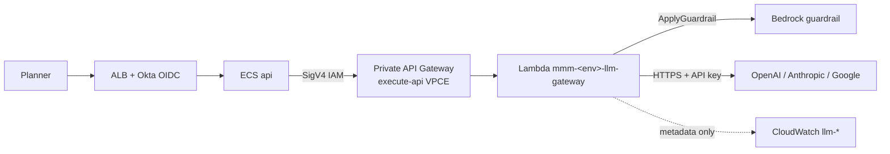

# 12 – Release 2: GenAI (LLM gateway and Bedrock guardrails)

Release 2 adds natural-language explanations of MMM results through approved external LLM providers
(OpenAI, Anthropic, Google). Traffic stays inside the VPC: the **API** task calls a **private API
Gateway** (execute-api VPC endpoint, IAM/SigV4) → **proxy Lambda** → the provider HTTPS API. Every
prompt and answer passes **Amazon Bedrock ApplyGuardrail** (guardrail module only; models are not
invoked through Bedrock). Start only after the Release 1 gate ([docs/11](11-release-1-readiness.md),
G5 inputs).

Two switches:

| Switch | Where | What it does |
|---|---|---|
| `enable_genai` | `infra/environments/<env>/terraform.tfvars` | Creates guardrail, LLM gateway, interface endpoints (`execute-api`, `bedrock-runtime`), alarms, and sets `LLM_GATEWAY_URL` on the API task |
| `genai_enabled` | same file → SSM `/mmm/<env>/genai_enabled` | Feature flag the API reads: users see GenAI only when it is `true` |

## 1. What gets built



| Resource | Name (dev) | Code |
|---|---|---|
| KMS key | `alias/mmm-dev-genai` | `main.tf` (module `kms`, purpose `genai`) |
| Guardrail + pinned version | `mmm-dev-genai` | module `bedrock-guardrails` |
| Private REST API + proxy Lambda | `mmm-dev-llm-gateway` | module `llm-gateway` |
| Interface endpoints | `execute-api`, `bedrock-runtime` | `genai.tf` / `network` |
| Provider secrets | `mmm/dev/llm/openai`, … | `secrets` module (values out of band) |
| API task env | `LLM_GATEWAY_URL` | `ecs.tf` when `enable_genai` |
| Per-BU token quotas | SSM `/mmm/dev/genai/token_quota/<bu>` | `genai_token_quotas` tfvar (read by the API) |
| Alarms | `mmm-dev-llm-gateway-5xx`, `mmm-dev-genai-guardrail-interventions` | `llm-gateway`, `bedrock-guardrails` |
| CI / infra | no separate gateway app image | Lambda code in `infra/modules/llm-gateway/lambda/` |

## 2. Controls

| Requirement | How it is enforced |
|---|---|
| Only WBD-approved providers | `llm_providers` tfvar; API Gateway returns 404 for unknown path prefixes |
| Gateway reachable only from the API task | Resource policy allows `execute-api:Invoke` only for the API task role; deny unless `aws:SourceVpce` is the execute-api endpoint |
| Guardrail on every call | Lambda calls `bedrock:ApplyGuardrail` on input and on successful provider JSON output |
| Prompt injection / harmful content | Guardrail content filters (prompt-attack HIGH on input; hate/insults/sexual/violence/misconduct MEDIUM) |
| PII | Guardrail PII entities anonymized or blocked per module defaults |
| Grounding (when the API sends sources) | Contextual grounding + relevance thresholds (`genai_grounding_threshold`, `genai_relevance_threshold`) |
| No prompt/answer text in logs | Lambda logs provider, path, status, latency, token usage metadata only |
| Cost / abuse | Per-BU daily token quotas in SSM (API); Lambda `genai_reserved_concurrency`; API Gateway stage throttling; account budget `monthly_budget_usd` |

## 3. Turning it on (per environment: dev → staging → prod)

1. Obtain WBD data-egress and Responsible AI sign-off ([docs/01](01-client-inputs-tracker.md)).
2. In `infra/environments/<env>/terraform.tfvars`: `enable_genai = true`, `llm_providers` with WBD
   base URLs, `genai_token_quotas`, `genai_reserved_concurrency`, `manage_apigw_account_logging_role`
   (set `false` if WBD already owns the account-level API Gateway CloudWatch role), guardrail
   thresholds / `genai_guardrail_version_label`. Leave `genai_enabled = false` until validation.
   PR → plan → apply (`terraform.yml`).
3. Fill each provider secret out of band:
   `aws secretsmanager put-secret-value --secret-id mmm/<env>/llm/<provider> --secret-string '{"api_key":"<key>"}'`
   (names in `terraform output -json genai` → `provider_secrets`).
4. Force a new **api** deployment so tasks pick up `LLM_GATEWAY_URL` from the task definition
   (apply updates the env var; ECS rolling deploy via `deploy.yml` or
   `aws ecs update-service --cluster mmm-<env>-ecs --service mmm-<env>-api --force-new-deployment`).
5. Validate (section 7), then set `genai_enabled = true` in tfvars (PR → apply) and force a new API
   deployment again.

## 4. Changing the guardrail or providers

- **Guardrail policy:** change module inputs / tfvars and bump `genai_guardrail_version_label`
  (`v1` → `v2`). Apply publishes a new immutable version; redeploy is not required for Lambda env
  (guardrail id/version are in the Lambda environment at apply time). Restart API tasks if they
  cache guardrail metadata.
- **Providers:** update `llm_providers` (WBD approval), apply, add or rotate secrets. Removing a
  provider from the map removes its secret resource on apply (ensure the secret is empty or exported
  if WBD requires retention).

## 5. Monitoring and cost

- **Dashboard:** `mmm-<env>-platform` includes Lambda invocations/errors (proxy) and Step Functions;
  API Gateway 5xx is alarm-driven. Access logs: `/aws/apigateway/mmm-<env>-llm-gateway`; proxy logs:
  `/aws/lambda/mmm-<env>-llm-gateway`.
- **Alarms** (SNS `mmm-<env>-alerts`): `mmm-<env>-llm-gateway-5xx`,
  `mmm-<env>-genai-guardrail-interventions`. Runbook: [runbooks/genai.md](runbooks/genai.md).
- **Quotas:** `/mmm/<env>/genai/token_quota/<bu>` from `genai_token_quotas`. The API enforces daily
  limits before calling the gateway.
- **Cost:** Provider usage appears in Cost Explorer under each vendor’s service name; track against
  `monthly_budget_usd` and WBD anomaly alerts. No separate GenAI-only budget resource in Terraform.

## 6. API contract (API ↔ LLM gateway)

The API calls the gateway only when `genai_enabled` is true and `LLM_GATEWAY_URL` is set (from
Terraform when `enable_genai` is true). Base URL shape (from `terraform output genai.gateway_url`):

`https://<api-id>-<vpce-id>.execute-api.<region>.amazonaws.com/v1`

**Authentication:** AWS SigV4, service `execute-api`, credentials = API task role.

**Routing:** `POST {LLM_GATEWAY_URL}/{provider}/{provider-native-path}`

Examples (provider paths are the vendor’s documented REST paths; bodies are vendor JSON):

```http
POST {LLM_GATEWAY_URL}/openai/v1/chat/completions
Content-Type: application/json
Authorization: AWS4-HMAC-SHA256 …

{ "model": "<WBD-approved model>", "messages": [ … ] }
```

```http
POST {LLM_GATEWAY_URL}/anthropic/v1/messages
…
```

The proxy forwards allowed headers (`content-type`, `anthropic-version`, …), injects the API key from
Secrets Manager, runs **ApplyGuardrail** on input text fields, then on output text. Responses:

| Status | Meaning |
|---|---|
| 400 | Guardrail blocked or intervened on input (`{"guardrail":"INTERVENED",…}`) |
| 404 | Unknown `provider` segment |
| 413 | Body over 1 MiB |
| 502/504 | Provider HTTP error or timeout (28 s) |
| 200 | Provider body, or `{"guardrail":"INTERVENED","output":"…"}` if output was changed |

Rules for the API team: send only data the user may see (BU isolation before the call); honour token
quotas; surface `guardrail: INTERVENED` as blocked or unverified content; label AI-generated text.

## 7. Validate Step 14

### Without AWS

```powershell
.\scripts\validate-modules.ps1 -Name bedrock-guardrails,llm-gateway,network
.\scripts\mock-plan.ps1 -Environment dev,staging,prod     # plan includes enable_genai = true when configured
```

### With AWS (after section 3)

```powershell
$env:AWS_PROFILE = "mmm-dev-devops"
$g = terraform output -json genai | ConvertFrom-Json
# 1. Gateway URL and alarms exist
$g.gateway_url
$g.alarms
# 2. execute-api endpoint (private DNS)
aws ec2 describe-vpc-endpoints --filters Name=service-name,Values=com.amazonaws.<region>.execute-api `
  --query "VpcEndpoints[0].{state:State,privateDns:PrivateDnsEnabled}"
# 3. Guardrail id/version match Lambda env
aws lambda get-function-configuration --function-name $g.proxy_function `
  --query "Environment.Variables.{id:GUARDRAIL_ID,ver:GUARDRAIL_VERSION}"
# 4. From an API task (ECS Exec): SigV4 call — use awscurl or small Python with botocore SigV4
#    POST $g.gateway_url/openai/v1/chat/completions with a minimal JSON body; expect 200 or provider 4xx if key/model wrong
# 5. Guardrail: send prompt-attack or SSN in the JSON body; expect 400 with guardrail INTERVENED
# 6. genai_enabled flag
aws ssm get-parameter --name /mmm/dev/genai_enabled --query Parameter.Value
```

Record results (and WBD review of sample answers) in the Release 2 sign-off.

## 8. Turning it off

| Level | Action | Effect |
|---|---|---|
| Users | `genai_enabled = false` (PR → apply), force new API deployment. Emergency: SSM overwrite + redeploy, then PR | GenAI hidden in the app |
| Traffic | Scale API still calls gateway if code path runs; use flag first | No user-facing GenAI |
| Infrastructure | `enable_genai = false` (PR → apply) | Removes API Gateway, Lambda, guardrail resources managed by Terraform (published guardrail versions may remain with `skip_destroy`) |
