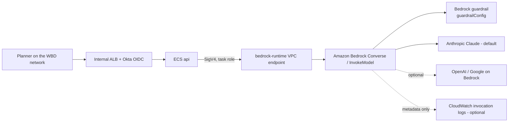

# 12 – Release 2: GenAI (Amazon Bedrock and Bedrock Guardrails)

Release 2 adds natural-language explanations of MMM results with **Amazon Bedrock**. **Anthropic
Claude is the default model**; OpenAI and Google models on Bedrock are optional alternatives for
experimentation (dev / staging, after approval). Traffic stays inside the VPC: the **API** task calls
Bedrock (Converse / InvokeModel) through the **`bedrock-runtime` VPC endpoint** with its IAM task
role, and every call carries **`guardrailConfig`** (the pinned Bedrock guardrail checks the prompt
and the answer). There is **no API Gateway, no proxy Lambda and no provider API key** (v6
architecture). Start only after the Release 1 gate ([docs/11](11-release-1-readiness.md), G5 inputs).

Two switches:

| Switch | Where | What it does |
|---|---|---|
| `enable_genai` | `infra/environments/<env>/terraform.tfvars` | Creates the guardrail, the `bedrock-runtime` endpoint (policy: approved models only), the API role's Bedrock access, SSM `genai/*`, alarms and dashboard, and sets `BEDROCK_*` on the API task |
| `genai_enabled` | same file → SSM `/mmm/<env>/genai_enabled` | Feature flag the API reads: users see GenAI only when it is `true` |

## 1. What gets built



| Resource | Name (dev) | Code |
|---|---|---|
| KMS key | `alias/mmm-dev-genai` | `main.tf` (module `kms`, purpose `genai`) |
| Guardrail + pinned version | `mmm-dev-genai` | module `bedrock-guardrails` |
| Interface endpoint | `bedrock-runtime` (endpoint policy: approved models, this account) | `genai.tf` / `network` |
| API task role access | `bedrock:InvokeModel` / `InvokeModelWithResponseStream` on the approved model / inference-profile ARNs **with the guardrail** (`bedrock:GuardrailIdentifier`), `bedrock:ApplyGuardrail`, `kms:Decrypt` on the genai key | `genai.tf` → `ecs.tf` |
| API task env | `BEDROCK_MODEL_ID`, `BEDROCK_GUARDRAIL_ID`, `BEDROCK_GUARDRAIL_VERSION` | `ecs.tf` when `enable_genai` |
| SSM | `/mmm/dev/genai/model_id`, `genai/optional_model_ids` (JSON), `genai/guardrail` (JSON id + version), `genai/token_quota/<bu>` | `main.tf` (`secrets` module) |
| Optional: application inference profile per BU | `mmm-dev-genai-<bu>` (+ SSM `genai/inference_profile/<bu>`) | `enable_genai_bu_inference_profiles` |
| Optional: model invocation logging | `/aws/bedrock/mmm-dev-model-invocations`, role `mmm-dev-bedrock-invocation-logging` | `enable_bedrock_invocation_logging` (account-level; metadata only unless `bedrock_invocation_log_text`) |
| Alarms | `mmm-dev-bedrock-invocation-errors`, `-bedrock-throttles`, `-bedrock-latency-p95`, `-genai-guardrail-interventions`, `-genai-tokens-<bu>` | `genai.tf`, `bedrock-guardrails` |
| Dashboard | `mmm-dev-genai` (AWS/Bedrock invocations, errors, throttles, latency, tokens per model; tokens per BU) | module `monitoring` |
| Permission boundary | `bedrock:InvokeModel*` also allowed in `genai_inference_regions` (cross-region inference profile) | module `permission-boundary` |

## 2. Controls

| Requirement | How it is enforced |
|---|---|
| Only approved models | `genai_model_ids` (first = Anthropic default, validated); IAM resources and the endpoint policy list only these model / profile ARNs; Bedrock model access is granted per model in the account |
| Guardrail on every call | IAM condition `bedrock:GuardrailIdentifier` = `<guardrail ARN>:<pinned version>` – a call without the guardrail is denied |
| Private path only | `bedrock-runtime` interface endpoint with private DNS; endpoint policy allows only this account's principals |
| Prompt injection / harmful content | Guardrail content filters (prompt-attack HIGH on input; hate / insults / sexual / violence / misconduct MEDIUM) |
| PII | Guardrail PII entities anonymized or blocked per module defaults |
| Grounding (when the API sends sources) | Contextual grounding + relevance thresholds (`genai_grounding_threshold`, `genai_relevance_threshold`) |
| No prompt / answer text in logs | Invocation logging off by default; when on, metadata only (`bedrock_invocation_log_text = false`) unless WBD Privacy approves |
| Cost / abuse | Per-BU daily token quotas in SSM (API) + `genai-tokens-<bu>` alarms; Bedrock tokens / requests per minute quotas; optional per-BU inference profiles for cost allocation; account budget `monthly_budget_usd` |
| Experimental models | OpenAI / Google only in dev / staging `genai_model_ids`; prod tfvars has the default Anthropic model only |

## 3. Turning it on (per environment: dev → staging → prod)

1. Obtain WBD Responsible AI sign-off and the model list ([docs/01](01-client-inputs-tracker.md)).
2. In the account (WBD infra / DevOps): **Bedrock model access** for the models in `genai_model_ids`;
   check the Bedrock tokens / requests per minute quotas; if the model ID is a cross-region inference
   profile (`us.…`), the WBD SCP must allow its destination regions (`genai_inference_regions`).
3. In `infra/environments/<env>/terraform.tfvars`: `enable_genai = true`, `genai_model_ids`,
   `genai_inference_regions`, `genai_token_quotas`, guardrail thresholds / `genai_guardrail_version_label`,
   optional `enable_genai_bu_inference_profiles` and `enable_bedrock_invocation_logging` (`false` if WBD
   already manages invocation logging in the account). Leave `genai_enabled = false` until validation.
   PR → plan → apply (`terraform.yml`).
4. Force a new **api** deployment so tasks pick up the `BEDROCK_*` variables
   (`deploy.yml` or `aws ecs update-service --cluster mmm-<env>-ecs --service mmm-<env>-api --force-new-deployment`).
5. Validate (section 7), then set `genai_enabled = true` in tfvars (PR → apply) and force a new API
   deployment again.

## 4. Changing the guardrail or models

- **Guardrail policy:** change module inputs / tfvars and bump `genai_guardrail_version_label`
  (`v1` → `v2`). Apply publishes a new immutable version and updates the IAM condition, SSM
  `genai/guardrail` and `BEDROCK_GUARDRAIL_VERSION` together; redeploy the API afterwards.
- **Models:** change `genai_model_ids` (WBD approval, model access in the account first), apply,
  redeploy the API. The first entry must stay an Anthropic model (default). Experimental models go
  into dev / staging only.

## 5. Monitoring and cost

- **Dashboard:** `mmm-<env>-genai` – `AWS/Bedrock` `Invocations`, `InvocationClientErrors`,
  `InvocationServerErrors`, `InvocationThrottles`, `InvocationLatency` p50 / p95, `InputTokenCount` /
  `OutputTokenCount` per model; app metric `GenAITokens` per BU.
- **Alarms** (SNS `mmm-<env>-alerts`): `bedrock-invocation-errors` (client + server errors >
  `bedrock_error_alarm_threshold` in 5 min), `bedrock-throttles` (15 min), `bedrock-latency-p95`
  (> `bedrock_latency_p95_ms` for 15 min), `genai-guardrail-interventions`, `genai-tokens-<bu>`.
  Runbook: [runbooks/genai.md](runbooks/genai.md).
- **Quotas:** `/mmm/<env>/genai/token_quota/<bu>` from `genai_token_quotas`. The API enforces daily
  limits before calling Bedrock.
- **Cost:** Bedrock usage appears in Cost Explorer under Amazon Bedrock (per model); with the per-BU
  application inference profiles, by the `BusinessUnit` tag.

## 6. API contract (API ↔ Bedrock)

The API calls Bedrock only when `genai_enabled` is true. It reads the model and guardrail from the
task environment (`BEDROCK_MODEL_ID`, `BEDROCK_GUARDRAIL_ID`, `BEDROCK_GUARDRAIL_VERSION`) or SSM
`genai/*`; with per-BU profiles it uses `genai/inference_profile/<bu>` as the model ID.

```python
bedrock = boto3.client("bedrock-runtime")       # private DNS -> bedrock-runtime VPC endpoint
bedrock.converse(
    modelId=os.environ["BEDROCK_MODEL_ID"],
    messages=[...],
    guardrailConfig={
        "guardrailIdentifier": os.environ["BEDROCK_GUARDRAIL_ID"],
        "guardrailVersion": os.environ["BEDROCK_GUARDRAIL_VERSION"],
        "trace": "enabled",
    },
)
```

| Result | Meaning |
|---|---|
| `stopReason = guardrail_intervened` | Guardrail blocked the prompt or the answer – show the blocked message |
| `AccessDeniedException` | Model not in `genai_model_ids`, model access not granted, or no / wrong `guardrailConfig` |
| `ThrottlingException` | Bedrock quota – retry with backoff; `bedrock-throttles` alarm |
| `ValidationException` | Request shape / model parameters |

Rules for the API team: send only data the user may see (BU isolation before the call); honour token
quotas; publish `GenAITokens`; surface guardrail interventions as blocked content; label AI-generated text.

## 7. Validate Step 14

### Without AWS

```powershell
.\scripts\validate-modules.ps1 -Name bedrock-guardrails,network,permission-boundary,monitoring
.\scripts\mock-plan.ps1 -Environment dev     # run plan_all_features has enable_genai = true with optional models
```

### With AWS (after section 3)

```powershell
$env:AWS_PROFILE = "mmm-dev-devops"
$g = terraform output -json genai | ConvertFrom-Json
# 1. Models, guardrail and alarms
$g.default_model_id; $g.guardrail_id; $g.guardrail_version; $g.alarms
# 2. bedrock-runtime endpoint (private DNS) and its policy
aws ec2 describe-vpc-endpoints --vpc-endpoint-ids $g.bedrock_endpoint_id --query "VpcEndpoints[0].{state:State,privateDns:PrivateDnsEnabled}"
# 3. Model access
aws bedrock get-foundation-model-availability --model-id anthropic.claude-sonnet-4-5-20250929-v1:0
# 4. API task env matches the guardrail
aws ecs describe-task-definition --task-definition mmm-dev-api --query "taskDefinition.containerDefinitions[0].environment[?starts_with(name,'BEDROCK_')]"
# 5. From an API task (ECS Exec): converse WITH guardrailConfig -> 200; WITHOUT -> AccessDeniedException
# 6. Guardrail: prompt-attack or an SSN in the prompt -> stopReason guardrail_intervened
aws ssm get-parameter --name /mmm/dev/genai_enabled --query Parameter.Value
```

Record results (and WBD review of sample answers) in the Release 2 sign-off.

## 8. Turning it off

| Level | Action | Effect |
|---|---|---|
| Users | `genai_enabled = false` (PR → apply), force new API deployment. Emergency: SSM overwrite + redeploy, then PR | GenAI hidden in the app |
| One model | Remove it from `genai_model_ids` (PR → apply) | The API role and the endpoint policy no longer allow it |
| Infrastructure | `enable_genai = false` (PR → apply) | Removes the endpoint, IAM access, alarms, profiles and logging config (published guardrail versions remain with `skip_destroy`) |
